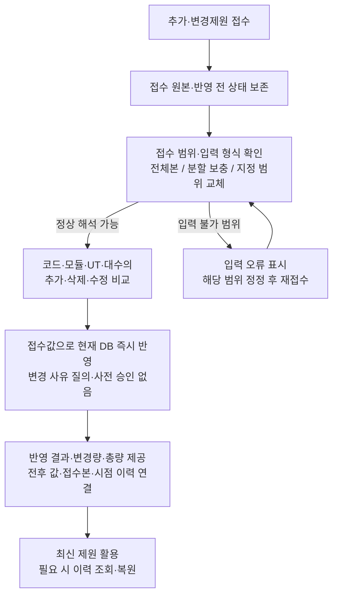
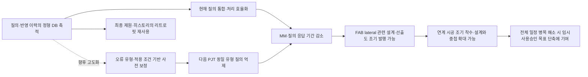
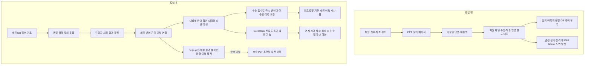

# 제원 질의 데스크 사내 특허 제안서 — 지정양식 v14

작성일: 2026-10-25 | 추가·변경제원 즉시 반영 정책 및 단순 처리 흐름 반영

공유 방침: 사용자는 별도 외부 발표 없이 사내 활용을 계획하고 있으며, 2026-10-24 공개 상태인 기존 GitHub 저장소에도 본 수정본을 올리도록 명시적으로 요청하였다. GitHub 게시와 별도의 외부 발표 계획은 구분하여 1.4절에 기재한다.

본 문서는 사용자 지정 10개 항목을 유지하고, **PPT로 주고받던 제원 질의·답변을 정형 DB로 축적하고 실제 최종 반영까지 연결하여, 후속 PJT와 리트로핏에 재사용하는 데이터 기반을 만드는 것**을 강조한 검토본이다. 답변 완료와 실제 반영 완료의 구분은 현재의 핵심이며, 축적된 오류 유형·해결 이력을 통한 후속 PJT의 질의 사전 해소 및 자동 제원 보정은 향후 고도화이다. 질의 단축에서 선출도 조기 발행·시공 중첩·임시사용승인 목표시점 단축으로 이어지는 효과는 단계별 조건을 구분하여 설명한다. 정량 효과는 시험 목표이며 신규성·진보성 및 출원용 청구범위 검토는 완료되지 않았다.

## 1. 발명의 서지정보

### 1.1 발명의 명칭

**제원 질의 처리 이력의 정형화 및 최종 반영 확인을 이용한 반도체 설비 제원 데이터 관리 방법 및 시스템**

영문명: Method and System for Managing Semiconductor Equipment Specification Data Using Structured Query Processing Histories and Final Incorporation Verification.

### 1.2 발명 핵심 키워드

제원 질의·답변 정형 DB, 최종 제원 반영 확인, 오류 유형 분석, 확정 결과 재사용, 대공정별 통합 처리, 변경 이력, 리트로핏, 향후 자동 제원 보정, 선출도 조기 발행, 설계·시공 중첩.

### 1.3 외부 공동출원인 여부

**외부 공동개발·공동출원 약정 없음 — 사용자 확인.** 사내 업무 플랫폼으로 사용한다. 발명자 및 사내 출원인 표기는 사내 제출 시 확정한다. 유량 기준 협의에 외부 설계사가 참여했다는 사실만으로 공동출원으로 기재하지 않는다.

### 1.4 논문·학회 발표 등 외부 공개 및 예정 여부

| 구분 | 현재 확인 내용 |
|---|---|
| GitHub 공개 | 사용자 요청에 따라 2026-10-22 공개 저장소에 특허 초안과 선행조사 보고서를 게시함 |
| 플랫폼 코드 공개 | 공개 GitHub 저장소를 참고하여 작성함. 코드의 최초 공개일과 당시 공개 범위는 별도 확인 필요 |
| 향후 논문·학회·외부 발표 | 별도 계획 없음. 업무 활용은 사내 공유 중심 |
| 사내 공유 | 사내 특허 제안 및 업무 적용을 위한 공유 예정 |
| 과거 기타 외부 공유 | 원문 아티팩트 등 다른 경로의 공개 범위·최초 공개일은 미확인. 향후 방침과 구분 |

향후 사내 공유 방침과 기존 GitHub 공개 이력을 구분한다. 과거 공개가 없었다고 기재하지 않으며, 공개 경위·시점·당시 내용을 사내 특허 담당자에게 전달하여 검토에 반영한다. 이번 수정본은 공개 저장소 상태를 안내한 뒤 사용자의 명시적인 업로드 요청을 받아 게시한다.

### 1.5 선행기술자료

대표 비교자료는 [CN111859479B](https://patents.google.com/patent/CN111859479B/en)와 [US7054885B1](https://patents.google.com/patent/US7054885B1/en)이다. 확인 범위와 차이점은 2절에 기재한다.

| 구분 | 자료 및 공개 정보 | 관련 사항 |
|---|---|---|
| P1 | [CN111859479B](https://patents.google.com/patent/CN111859479B/en), B공보 2024-02-20, A공보 2020-10-30 | PDM의 설계 변경·승인·버전 및 차이 저장 |
| P2 | [US7054885B1](https://patents.google.com/patent/US7054885B1/en), 2006-05-30 | 설계 구성항목의 버전·변경 패키지·병합과 해결 기록 |
| P3 | [US20190332699A1](https://patents.google.com/patent/US20190332699A1/en), 2019-10-31 | DB 충돌 표시 및 해결 선택, 세 버전 병합 |
| P4 | [US20130262419A1](https://patents.google.com/patent/US20130262419A1/en), 2013-10-03 | 구조 의미·규칙에 따른 비교 및 병합 |
| P5 | [KR20050069985A](https://patents.google.com/patent/KR20050069985A/en), 2005-07-05 | 건설 구성요소 식별자·상태·관련 파일의 DB 연결 |
| N1 | [Khanna 등, A Formal Investigation of Diff3, 2007](https://www.cis.upenn.edu/~sanjeev/papers/fsttcs07_diff3.pdf) | 공통 기준 상태와 두 파생 상태를 비교하는 기존 기법 |
| N2 | [W3C PROV-O, 2013](https://www.w3.org/TR/2013/REC-prov-o-20130430/) | 데이터·활동·책임 주체 및 파생 관계 표현 |
| N3 | [buildingSMART BCF 3.0 기술문서](https://github.com/buildingSMART/BCF-XML/blob/release_3_0/Documentation/README.md) | 설계 이슈·담당자·문서·답변 연결 |

GCS 후보의 인접 자료로 [EP1078887A1](https://patents.google.com/patent/EP1078887A1/en)의 CMP 폐수 처리, [CN107705235A](https://patents.google.com/patent/CN107705235A/en)의 폐기물 속성·호환관계 DB, [Systematic Waste Minimization in Chemical Processes. 2. Intelligent Decision Support System](https://pubs.acs.org/doi/10.1021/ie0102089)의 폐기물 발생원 분석을 검색하였다. 이들 자료가 본 제안의 장비 단위 양방향 제원 검증과 동일하다고 판단한 것은 아니다.

선행특허·참고문헌은 본 문서 1.5절 및 2절에 정리하였다. 국내 일부 자료는 검색 결과에 재현된 공보 내용, 논문 일부는 초록 확인에 한정한다. 등록 청구항·패밀리·사내 비공개 출원의 전체 조사는 미완료이다.

### 1.6 당사 제품 적용 계획

| 항목 | 기재 내용 |
|---|---|
| 직접 적용 대상 | 삼성전자 반도체 신축 및 리트로핏 PJT의 제원 검토·질의·변경 관리용 사내 플랫폼 |
| 플랫폼 명칭 | 제원 질의 데스크 / 제원관리 플랫폼 |
| 당사 제품 모델명 | 해당 없음 — 사내 업무 플랫폼 |
| 제품 출하시기 | 해당 없음 — 외부 출하 제품이 아닌 사내 업무 플랫폼 |
| 현장 적용 계획 | 2026-11-30부터 후속 PJT 적용 예정. PJT 명칭은 미기재 |
| 효과 검증 | 실제 적용 후 확인 필요. 예상 질의 기간 단축 목표는 약 4주 |
| 개발 단계 | 정식 운영 전 데모 |

P4·P5는 향후 프로젝트 간 비교 예시이며 실제 적용 PJT나 제품 모델로 확정한 명칭이 아니다. 11월 30일은 이번 사용자 답변의 2026년 적용 일정으로 기재하였다.

## 2. 대표 선행기술 VS 본 발명의 차이점

### 2.1 대표 선행기술 P1과의 비교

대표 선행기술: CN111859479B, Engineering change full life cycle management method and system in PDM system. B공보의 설명과 청구항 1 등을 확인하였다. 청구 구성에는 기술 파라미터 제약관계, 변경 승인·버전 결과 및 정규화 후 차이 계산이 포함된다. A공보와 B공보의 전 문언 대조는 미수행이다.

| 비교 항목 | 대표 선행기술 P1 | 본 발명에서 구체화하는 내용 |
|---|---|---|
| 목적 | 설계 변경에 따른 기술 파라미터·절차의 연계 관리 | 질의 답변의 실제 최종 제원 반영을 확인하고, 처리 경험을 후속 PJT·리트로핏에 활용 |
| 구성요소 | 설계 노드·제약 규칙·변경 승인·결과 버전·차이 DB | 질의별 대상·항목별 추천값 및 적용·유지 결정·승인에 따른 자동 갱신·판단 근거·담당자·처리시점·수정 이력 연결 |
| 효과 | 변경에 따른 반복 소통 감소 및 협업 효율 향상이라는 취지 | 미반영 식별과 최종본 대조 부담 감소, 반복 오류 분석·재사용을 위한 기반 형성 기대 |
| 차이점 | 변경 승인 및 변경 결과의 버전 관리 구조 | 추천값이 다른 대상도 통합 검토하면서 항목별 적용·유지를 구분하고, 승인 결과의 자동 갱신·수정 이력을 분석용 DB에 연결하는 구조를 구체화 |

확인한 문헌에 질의 대상별 반영 확인 구성 전체가 없다고 단정하지 않는다. 위 내용은 실제 구성 대조를 위한 비교 방향이다. ‘반도체에 적용’, ‘DB로 저장’만을 차별점으로 삼지 않는다.

### 2.2 대표 선행기술 P2와의 비교

대표 선행기술: US7054885B1, Method and system for managing the configuration of an evolving engineering design using an object-oriented database. 변경 패키지 및 병합 예시와 청구항 1 등을 확인하였다.

| 비교 항목 | 대표 선행기술 P2 | 본 발명 및 추가 설계안 |
|---|---|---|
| 목적 | 병행 설계 변경의 보존·병합 및 구성 관리 | 확정 질의 결과가 실제 제원에 적용됐는지 확인하고 후속 전체본의 미반영 후보 식별 |
| 구성요소 | 구성항목·변경 시작 상태·변경 패키지·해결 기록 | 질의별 확정 결과와 항목별 적용 이력, 접수 직전 현재본·신규본, 과거 승인 이력과 신규 반영 이력 |
| 효과 | 변경 손실을 줄이고 상충 변경 해결 지원 | 질의 수정분의 되돌림·미반영 후보 구분과 실제 반영 변경량의 오집계 감소 기대 |
| 차이점 | 일반적인 병합과 사용자 해결 기록 | 질의 완료·실제 반영의 업무 의미를 이용해 후보를 분류하고 최신 접수값 반영과 기존 승인 이력의 보존·조회 관계를 구체화하는 구조 |

세 상태 비교 및 해결 기록 자체는 기존 기술이다. 최신 후속 접수 정책은 사전 질의·승인 없이 신규값을 반영하고 과거 승인 이력을 보존하는 방식이다. GCS 정합성 검증은 추가 설계이며 구현 또는 선행기술 대비 권리성을 확정하지 않는다.

### 2.3 GCS 후보의 차별화 방향

기존에 검색된 폐수 처리·폐기물 호환성 판단과 구분하여, **같은 장비의 공급 케미컬·슬러리 제원과 폐액 제원을 양방향 대조하고, 불일치 질의를 처리한 뒤 양쪽 제원의 실제 반영을 재확인하는 연결 구조**를 조사한다. 복수 자재가 하나의 폐액에 대응할 수 있다는 점을 반영한다. 여러 케미컬이 하나의 폐액탱크에 대응하는 다대일 관계는 사내 환경그룹의 명확한 기준에 따른다. 실제 기준표의 시스템 표현과 검증 구현 여부는 추가 확인 대상이다.

### 2.4 실제 현행 업무 대비 변화 — 선행특허 비교와 구분

| 항목 | 기존 현행 업무 | 플랫폼 적용 방향 |
|---|---|---|
| 질의·답변 | 설계사가 PPT로 제원 질의, 각 공정별 기술팀이 검토·답변 | 장비·항목·담당자에 연결된 질의 처리 |
| 이력 보존 | PPT 기록은 존재하더라도 질의·답변이 정형 DB로 축적되지 않음 | 질의·오류 유형·확정 조치·실제 반영·시점을 DB로 축적 |
| 데이터 활용 | 개별 파일을 다시 찾아 해석해야 함 | 오류 유형·발생 조건·처리 결과의 조회·분석 및 재사용 |
| 후속 PJT | 같은 유형의 질의를 다시 수행 | 향후 검증된 적용 조건에 맞는 제원은 사전 보정하여 같은 질의 발생 억제 |
| 후속 공사 | 최종 제원과 변경 근거를 재확인 | 질의 결과가 반영된 최종 제원 및 이력을 리트로핏 검토에 활용 |

위 표는 사용자가 설명한 현행 업무와의 비교이다. 사내에서 DB를 새로 구축했다는 사실이 특허 선행기술 전체에 대해 신규성을 입증하는 것은 아니며, 정형화되는 항목과 실제 반영 연결 및 재사용 처리의 구체적인 결합을 검토한다.

## 3. 발명의 상세한 내용

### 3.1 배경기술·종래기술 문제점 및 발명의 목적

현행 업무는 제원 접수 후 설계사 최초 검토 약 1주, PPT 질의 패키지 발행, 제조 기술팀과 답변 왕복 최소 5근무일 이상, 재질의 및 후속 패키지로 진행된다. 프로젝트당 패키지는 약 10회 이상이다. 최초 검토 1주와 별도로 질의·검토 기간은 약 2개월이다.

대표 프로젝트 규모는 장비 약 1,500대이며 개별 질의는 약 300~400건 예상이다. 설계사·협력사 약 120명, 삼성전자 담당자 약 50명이 참여할 것으로 예상된다. 패키지와 개별 질의를 구분하며, 참여 인원은 전담 투입인원이 아니다.

기존에는 설계사가 PPT로 질의를 제기하고 각 공정별 기술팀이 답변을 검토했다. 이 질의·답변 및 판단 과정이 정형 DB로 남지 않아, 해결 경험을 장비·항목·오류 유형별로 분석하고 다음 PJT에서 재사용할 기반이 부족했다. PPT 파일의 보관과 분석 가능한 이력 DB의 축적은 구분된다.

기존에는 최초 및 후속 제원 양식이 제각각이어서 총량 집계에 수작업이 필요했다. 특히 GCS가 여러 차례 분할 접수되어 누적 총량을 파악하는 부담이 컸다. 사용자는 일반적인 양식 차이의 전체 영향보다 GCS 반복 분할 접수의 집계 부담을 강조하였다. 분할본을 PJT 전체본으로 오인해 미포함 장비를 삭제하지 않도록 접수 범위를 구분하는 설계가 필요하며, 이 구분의 자동 구현 여부는 확인되지 않았다.

또한 질의·답변이 제원 데이터와 분리되어 답변 완료가 실제 제원 반영 완료를 뜻하지 않았다. 복수 대상 중 일부만 수정되거나 후속 변경 접수로 수정값이 되돌아갈 수 있고, 담당자가 확인한 최종 제원을 찾기 어렵다.

제원 질의 기간과 연계되는 선출도는 주로 **FAB 내 lateral 발주·제작 도면**이다. 선출도는 공식 AFC 도면 발행 전에 나가는 도면을 뜻한다. PJT 전체 질의가 모두 끝날 필요는 없으며 해당 도면에 필요한 제원 범위가 정리되는 것이 중요하다. 대구경 배관 등은 PJT 제원 질의 완료보다 훨씬 먼저 선출도되어야 하므로, 모든 선출도·시공 착수를 제원 질의 종료에 종속시키지 않는다.

본 발명의 목적은 질의·답변·오류 유형·확정 결과·실제 반영을 정형 DB로 축적하고, 최종 제원 및 변경 근거를 확인 가능하게 하며, 동일 유형 질의를 통합하여 MM과 응답 기간을 줄이는 것이다. 축적된 이력은 후속 PJT의 반복 오류 분석 및 향후 자동 보정, 리트로핏의 기존 제원·변경점 검토에 재사용한다. 질의 기간 단축을 선출도 조기 발행 및 설계·시공 중첩 확대에 연결하는 것을 기대한다.

### 3.2 핵심 아이디어 요약

장비·제원 항목을 중심으로 질의 내용, 제원질의·레이아웃질의·기타질의의 분류, 기술팀 답변, 판단 근거, 항목별 적용·유지 결과, 수정 이력, 담당자 및 처리 시점을 연결하여 저장한다. 승인하면 해당 대상의 DB값이 자동으로 갱신되고 수정 이력이 제공된다. 이를 분석하는 제원분석 탭에서 유형별 건수·대공정별 반복오류·대공정 및 설비모듈별 질의·단계별 처리시간을 조회할 수 있다.

같은 질의 안에서 일부 대상은 추천값을 적용하고 나머지는 기존값을 유지할 수 있으며 그 결과를 구분해 확인할 수 있다. 반영 여부는 승인에 따른 자동 갱신 및 대상별 수정 이력·처리 결과로 확인하는 구조이다. 확정값과 현재값을 별도 비교하는 독립적인 반영 판정 엔진이 구현됐다는 설명은 사용하지 않는다.

향후에는 실제 반영까지 확인된 해결 결과와 적용 조건을 오류 유형별로 정리하여, 다음 PJT의 같은 조건에 해당하는 제원을 질의 전에 보정하는 방향으로 고도화한다. 반복 횟수만으로 무조건 자동전환하지 않고 검증된 조건·예외·정책을 갖춘 유형을 대상으로 한다. 현재 이 고도화의 규칙 확정 및 운영 검증은 완료되지 않았다.

이전 버전 셀의 값은 나중에도 조회 가능하다. 후속 변경에 의해 과거 승인 건을 자동으로 다시 미반영 판정하는 기능이나 별도의 시점별 상태 판정은 추가 설계로 구분한다.

### 3.3 발명이 적용되는 장치

설계사·기술팀 담당자의 단말, 제원·질의 데이터를 처리하는 컴퓨터 및 데이터 저장장치에 적용한다. 웹 서버와 DB를 사용하는 형태 또는 브라우저에서 공유 저장소를 이용하는 형태로 구현할 수 있다. 반도체 생산장비 제원을 다루는 정보처리 시스템이며, 현재 설명은 장비의 실제 밸브·배관을 직접 제어하는 구성을 요구하지 않는다.

## 4. 발명에 대한 상세한 설명

### 4.1 관리 정보와 연결 관계

| 정보 | 내용 및 관계 |
|---|---|
| 장비 정보 | PJT·건설코드·대공정, 설비 유형 구분용 PRC·MODEL·MAKER |
| 제원 항목 | UT 분류·성상·모듈 및 유량·압력·전력 등 해당 항목의 값 |
| 질의 | 대상 항목 집합, 질의 분류, 담당 대공정, 답변 및 처리 단계 |
| 확정 결과 | 대상별 추천값 적용 또는 기존값 유지 등의 처리 결과 및 시점 |
| 반영 이력 | 승인에 따라 실제 갱신된 대상과 전후 값, 판단 근거, 담당자, 처리 시점 및 복원 참조 |
| 분석용 처리 이력 | 질의 분류별 건수, 대공정별 반복오류, 대공정·설비모듈별 질의, 각 단계별 처리시간을 조회하는 정형 이력 |
| 최종 확인 | 대공정 담당자·확인 시점·확인 범위 및 해당 시점의 제원 상태 |
| GCS 규칙 | 같은 장비의 공급 자재와 폐액 사이 필수·허용·조건부 관계 — 추가 설계 |

하나의 건설코드 아래 메인 설비와 부대설비가 연결되고 설비모듈명이 다를 수 있다. 동일 건설코드 안에 PCW가 여러 번 있어도 서로 다른 설비모듈에 속하면 별개 항목이다. 사용자 확인상 동일 건설코드·동일 설비모듈 안에서 PCW가 두 줄 존재하지 않는다. 따라서 비교 항목은 PJT·건설코드·설비모듈·UT 헤더·UT 성상으로 식별하는 설계로 구체화한다. 설비모듈명 변경은 자동으로 동일 모듈이라고 단정하지 않고 변경점 확인 대상으로 둔다. 이 항목 식별 기준이 GCS 양방향 검증의 단위를 모듈 단위로 축소한다는 뜻은 아니며, GCS 검증은 기존 설명대로 같은 장비 범위이다.

### 4.2 질의 통합 및 처리

동일 유형의 질의는 대공정 담당자가 묶어서 검토한다. **대상별 추천값이 달라도 하나의 질의로 묶는 방침**이며, 기술팀 담당자가 추천값을 확인하는 기능을 제공한다. 묶음 전체에 하나의 공통 추천값을 강제 적용하는 구조로 기재하지 않는다.

대상별로 추천값 적용과 기존값 유지를 선택할 수 있으며 일부 적용 결과도 구분하여 확인할 수 있다. 각 대상은 자신의 기존값과 추천값을 유지하고 담당자 결정에 따라 갱신 또는 유지한다. 서로 다른 추천값의 통합 처리 방침은 사용자 확인 사항이며, 세부 화면·처리 실행을 이번 작업에서 새로 시험한 것은 아니다.

현재 분류는 **제원질의·레이아웃질의·기타질의**이다. 수동 질의는 사람이 유형을 정한다. 관리자가 규칙을 만들어 시스템에서 제원 질의를 자동 생성할 수 있으며, 규칙 기반 질의에 별도 오류 유형을 지정하는 것은 사용자 구현 방침이다. 현재 세 가지 분류를 유량 초과·전기 불일치 등 상세 오류 유형 자동 분류가 모두 구현된 것으로 확대 해석하지 않는다.

추천값은 명확한 기준이 있는 항목에 제공한다. 노즐 사이즈별 유량표는 전자·삼우설계 협의에 따른 권고·검토 기준으로, 초과만으로 저장·반영을 차단하거나 상한값으로 강제 수정하지 않는다. 전기 계산 및 IGPM·DS-EHS 매핑의 상세 조건은 추가 확인한다.

### 4.3 질의 결과의 실제 반영 확인 — 핵심 구성

실제 구현으로 확인된 동작은 **승인에 따른 DB 자동 갱신과 수정 이력 제공**이다. 질의가 답변 문서에서 끝나는 것이 아니라 대상 제원에 반영되고 대상별 처리 결과를 확인할 수 있다.

1. 질의 대상별 기존값·추천값과 기술팀 검토 결과를 관리한다.
2. 추천값 적용 대상과 기존값 유지 대상을 구분한다.
3. 승인하면 적용 대상의 DB값을 자동 갱신한다.
4. 판단 근거·담당자·처리 시점과 수정 이력을 남긴다.
5. 동일 질의에서 일부만 적용된 경우에도 적용 결과와 유지 대상을 구분하여 확인한다.

| 처리 상황 | 확인 내용 |
|---|---|
| 추천값 적용 승인 | 실제 갱신된 DB값과 수정 이력 |
| 기존값 유지 결정 | 적용 대상으로 바꾸지 않고 유지한 처리 결과 |
| 복수 대상 중 일부 적용 | 적용 항목과 유지 항목 구분 |
| 이전 업로드·질의 수정 단계 조회 | 이전 버전의 셀 값 |

의도적인 기존값 유지는 미반영 오류가 아니다. 제원 변경이 필요 없는 질의에도 값 변경을 요구하지 않는다. 별도의 확정값·현재값 재대조 엔진이나 자동 미반영 판정이 구현된 것으로 기재하지 않는다.

과거 반영 후 후속 변경된 상태를 자동 분리 판정하는 것은 추가 설계이다. 현재 확인된 기능은 승인에 따른 자동 갱신, 처리 결과·수정 이력 확인 및 이전 버전 셀 값 조회이다.

### 4.4 최종 제원 확인과 이력 복원

BULK 변경 전 기술팀 담당자가 특정 시점의 제원을 최종 제원으로 확인하는 절차를 둔다. 이는 후속 변경 접수를 허가하는 결재 게이트나 잠금이 아니다.

복원은 업로드 이후 및 개별 질의 수정 단계별로 가능하며, 사용자 설명상 모든 장비를 복원할 수 있다. 특정 장비만 선택해 복원하는지 전체 상태를 함께 복원하는지 등 선택 범위는 확정하지 않는다. 기술팀이 최종 확인한 당시 제원도 이전 버전의 셀 값으로 나중에 조회할 수 있다.

별도 결재본 파일을 새로 보관하는 것을 필수로 하지 않는다. 사용자 확인상 과거 버전 셀 조회와 단계별 복원이 구현되어 있고, 최종 확인자·확인시점·대상 범위를 해당 이력에 연결하는 세부 기능은 추가 실행 확인 대상이다. 과거 기록의 불변성·영구 보존을 주장하지 않는다.

### 4.5 추가·삭제·변경의 간단 정의

| 대표 구분 | 정의 |
|---|---|
| 추가 | 기존에 없는 건설코드 발생 |
| 삭제 | 신규 PJT 전체본에서 기존 건설코드 소멸 |
| 변경 | 동일 건설코드 안의 설비모듈·UT 구성·성상·제원값 또는 설비 대수 변동 |
| 유지 | 건설코드·설비모듈·UT 구성·설비 대수·관리 대상 제원값 모두 동일 |

동일 장비의 코드 변경이 확인되면 ‘변경—건설코드 변경’으로 연결할 수 있다. 대응표·확인 근거가 없으면 기존 코드 삭제와 신규 코드 추가 후보로 분류한다. 코드의 삭제·추가를 실제 철거·설치로 단정하지 않는다.

UT 상세 정의: 건설코드가 유지된 채 해당 장비의 WATER 등 UT 헤더에 속한 값 전체가 제거되면 ‘장비 변경—해당 UT 삭제’로 기록한다. 엑셀 파일 전체의 공통 열을 없앤다는 뜻과 구분한다. 유량 하나만 빈칸인 상태는 정상 입력이 아니므로 삭제나 0으로 해석하지 않고 입력 오류로 구분하는 설계 기준을 둔다. 수치 0의 업무 의미는 별도로 미확정이다.

### 4.6 추가·변경제원 즉시 반영 — 최신 업무 정책

**접수된 변경값을 최신 기준으로 사용한다. 변경 이유의 충분성이나 담당자의 사전 승인 여부를 반영 조건으로 삼지 않고, 추가·삭제·수정을 바로 현재 DB에 반영한다.** 변경됐다는 이유만으로 확인 질의·재승인·일괄 승인 단계를 만들지 않는다. 이전의 승인 대기 및 예외 질의 절차를 본 정책으로 대체한다.

업무 판단과 입력 가능 여부는 구분한다. 파일을 읽을 수 없거나 건설코드·설비모듈·UT를 식별할 수 없는 경우에는 그 범위만 입력 오류로 처리한다. 범위·자료를 정상적으로 해석할 수 있으면 사유 확인 없이 적용한다. 단순 권고값 초과나 과거 승인값과의 차이는 입력 오류가 아니다.

| 접수 유형 | 즉시 반영 범위 |
|---|---|
| PJT 전체본 | 전체 코드·모듈·UT·대수의 추가·삭제·수정 적용. 전체본에서 사라진 건설코드는 삭제 |
| 분할 보충본 | 제공된 신규 항목을 추가. 미포함 범위는 기존 상태 유지 |
| 지정 범위 교체본 | 지정 범위의 기존값을 접수값으로 교체. 해당 범위의 완전본에서 누락된 항목은 삭제 |
| 보충으로 접수했으나 기존값과 다른 값 포함 | 명확히 식별되는 제공 항목은 수정으로 기록하고 접수값 적용. 변경 사유 질의는 하지 않음 |
| 범위·대상·파일 해석 불가 | 해석 불가 범위만 입력 실패로 표시하고 무관한 기존 데이터를 임의 삭제하지 않음 |

분할 접수에서 보이지 않는 항목을 전체 삭제로 해석하지 않는다. 범위 식별은 파일 유형·업로드 선택 정보 등으로 처리하는 설계이며, 변경 이유에 대한 추가 결재가 아니다. 동일 건설코드의 서로 다른 설비모듈에 있는 PCW는 별개 항목으로 비교한다. 코드 전체 삭제와 그 하위 모듈·UT 삭제는 중복 집계하지 않는다.

#### 유량 예시

수치는 설명용 가정이다. 동일 장비·설비모듈의 PCW 유량을 같은 단위로 비교한다.

| 반영 전 → 접수값 | 처리 | 반영 후 / 실제 증감 |
|---|---|---|
| 80 → 90 L/min | 변경 근거를 묻지 않고 즉시 수정 | 90 / +10 L/min |
| 80 → 120 L/min | 노즐 권고값이 100이어도 즉시 수정. 권고 초과만으로 감액·반영 보류하지 않음 | 120 / +40 L/min |
| 최초 100 → 질의 승인 80 → 신규 접수 100 | 최신 접수값 우선 정책에 따라 100으로 수정하고 과거 승인 80은 이력에 보존 | 100 / +20 L/min |
| 해당 WATER 항목 삭제 | 전체본 또는 명확한 교체 범위에서 확인된 삭제를 즉시 적용 | 현재 항목 제거, 과거 값은 이력 보존 |
| 분할본에 기존 WATER가 없음 | 미포함 항목은 삭제로 간주하지 않음 | 기존 항목 유지 |

이번 정책은 후속 접수의 즉시 반영에 관한 것이다. 플랫폼의 기존 제원 질의·답변·승인에 따른 수정 기능은 별개로 유지한다. 변경 사유만을 묻는 질의는 만들지 않으며, 별도의 기존 검토 규칙을 사용하더라도 접수값 반영을 기다리게 하는 게이트로 두지 않는다. 모든 검토 규칙을 삭제하거나 모든 입력값의 기술적 타당성을 보장한다는 뜻은 아니다.

#### 이력과 복원

접수 원본, 적용 범위, 반영 전후 값, 접수·적용 시점 및 처리자를 연결하여 기록하는 설계로 정리한다. 입력한 값이 실제 DB에 반영됐는지와 적용·실패 범위를 결과에서 확인한다. 복원 시에는 되돌릴 접수 범위와 이후의 다른 정상 변경에 대한 영향을 구분한다. 변경량 산출·덮어쓰기·이전 단계 복원은 기존 사용자 확인상 구현이고, 최신 정책의 세부 예외까지 실행 시험한 것은 아니다.

### 4.7 과거 질의 승인 이력과 최신 접수값의 관계

본 수정에서는 사용자의 최신 지시인 **‘변경된 기준으로 묻지 않고 일단 반영’**을 후속 접수에 우선 적용한다. 이전 문서의 100→승인 80→재접수 100에서 80을 자동 유지하는 예외는 현재 처리 흐름에서 제외한다. 새 접수값 100을 현재 DB에 적용하고, 승인 80과 변경 사유·처리 이력은 과거 상태로 남긴다. 값이 같거나 다르다는 사실만으로 발행자의 의도를 추정하지 않는다.

접수 직전 현재값과 신규 접수값의 차이를 실제 변경량으로 계산한다. 예컨대 현재 80에서 신규 100으로 바뀌면 +20이며 최초본 100과 같다는 이유로 변경량을 0으로 처리하지 않는다. 실제 변경이 없는 항목은 값을 유지한다.

세 상태 비교는 필요 시 이력 분석용 추가 설계로 사용할 수 있으나 즉시 반영의 필수 조건 또는 자동 보류·재질의의 근거로 사용하지 않는다. 과거 질의가 실제 반영됐다는 기록과 그 이후 신규 접수로 현재값이 달라졌다는 기록을 함께 추적하는 것이 목적이다.

### 4.8 GCS 케미컬·슬러리와 폐액의 양방향 검증 — 추가 후보

검증 단위는 동일 장비이다. 사용자 확인상 여러 케미컬이 하나의 폐액탱크에 대응하는 다대일 관계이며, 사내 환경그룹에서 정한 명확한 기준을 사용한다. 매핑 기준을 플랫폼이 임의로 추정하거나 새로 정하는 것으로 기재하지 않는다. 다른 장비의 자재를 끌어와 해당 장비의 누락을 보완하지 않는다.

공급 자재에서 필요한 폐액의 존재·적합성을 검토하고, 등록 폐액에서 대응 가능한 공급 자재가 해당 장비에 있는지 역방향으로 확인한다. 관계는 일대일로 가정하지 않으며, 후보 중 하나가 존재하면 되는지 복수 조합이 필요한지는 실제 규칙으로 정한다. ‘허용 관계’를 ‘모두 필수’로 오해하지 않도록 구분한다.

사내 환경그룹의 엑셀 대응표는 존재하지만 플랫폼의 양방향 검증은 아직 구현되지 않았다. 엑셀의 케미컬명·폐액명이 플랫폼에서 인지하는 명칭과 달라 환경그룹의 표준화 또는 사용자 작성 매핑리스트가 선행되어야 한다. 규칙 추가로 구현할 계획이나 구현 난이도 예상과 구현 완료는 구분한다.

추가 설계에서는 원문 명칭을 보존하고 환경그룹 기준 명칭과의 대응을 별도 목록으로 관리한다. 예시 관리 항목은 자료 출처·원문명·대응 기준명·자재/폐액 구분·확인 상태·기준 버전이다. 미매핑 또는 복수 후보가 있는 이름은 판정 보류 대상으로 구분하고, 명칭 유사성만으로 자동 확정하거나 농도·성분 차이를 제거하지 않는다. 명칭을 대응시키는 목록과 케미컬에서 폐액탱크로 이어지는 업무 대응표는 역할이 다르다. 실제 명칭 예시와 기준 관리 책임의 세부 내용은 추후 구체화한다. IPA·SB-870·ACT-945 등을 특정 폐액으로 확정 매핑하지 않으며, 실제 성상·농도·사내 기준 확인 없이 혼합 배출 적합성을 의미하도록 서술하지 않는다.

### 4.9 정형 이력의 축적·분석 및 후속 PJT 재사용

현재 DB는 제원질의·레이아웃질의·기타질의 분류와 판단 근거·담당자·처리 시점을 저장한다. 제원분석 탭에서는 다음을 조회할 수 있다.

| 현재 조회 기능 — 사용자 확인 | 활용 |
|---|---|
| 질의·오류 유형별 건수 | 현재 분류별 처리 규모 확인 |
| 대공정별 반복오류 | 반복 검토 업무 파악 |
| 장비유형별 질의 — 대공정·설비모듈 기준 | 해당 분류별 검토 부담 확인 |
| 각 단계별 처리시간 | 대기·처리 병목 및 효율 분석 |

장비의 동일 유형 판정에 쓰는 PRC·MODEL·MAKER와 분석 화면의 대공정·설비모듈 분류 축은 구분한다. 현재 질의 분류와 규칙별 상세 오류 유형 지정 예정도 구분한다.

향후에는 실제 반영이 확인된 해결 결과와 적용 조건을 보정 규칙으로 정리하여 다음 PJT에서 같은 조건의 제원을 사전 보정하는 방향으로 고도화한다. 조건 불일치·상충 이력·예외는 일반 질의로 처리한다. 반복 횟수만으로 자동 전환하거나 권고 유량을 무조건 강제 적용하지 않는다. 규칙의 별도 상세 오류 유형 지정과 후속 PJT 자동 보정은 현재 분석 조회 기능과 별개이다.

### 4.10 리트로핏에서의 최종 제원·히스토리 활용

신축 PJT에서 질의 결과를 반영한 최종 제원과 후속 변경 이력을 리트로핏의 검토 기준으로 참조한다. 기존 장비의 공급·배출 제원, 확정 사유 및 변경 시점을 조회하고 새 접수 제원과 비교하여 변경량과 추가 확인 대상을 산출하는 방향이다.

당시 확정 제원과 실제 현장이 이후에도 항상 같다는 의미는 아니다. 리트로핏 기준 시점을 정하고 후속 변경의 반영 범위를 확인하여 사용한다. 공급 여유량·배관 용량 및 대응 가능 여부 자동 판정은 추가 데이터와 규칙이 필요한 장기 확장이다.

## 5. 아이디어의 변형 또는 회피에 따른 다양한 실시예

다음은 특정 화면·파일·저장 방식에 의존하지 않고 핵심 연결을 구현하는 변형안이다. 실제 청구범위의 포섭 여부를 확정한 것은 아니다.

| 실시예 | 변형 구성 | 공통으로 유지할 핵심 |
|---|---|---|
| A. 서버형 | 사용자 단말·서버·관계형 DB로 처리 | 질의 대상·결과·실제 반영·시점 연결 |
| B. 브라우저형 | 브라우저와 공유 저장소로 처리 | 같은 연결과 반영 확인을 제공 |
| C. 개별·묶음 처리 | 같은 유형을 묶거나 대상별로 처리 | 복수 대상의 반영은 각각 확인 |
| D. 결과 표현 | 화면 배지 대신 보고서·목록·알림으로 제공 | 답변 완료와 반영 결과를 별도 제공 |
| E. 이력 참조 | 변경 차이 누적·과거 상태 참조·시점별 기록 등으로 복원 | 조회 기준 시점과 현재값의 차이 구분 |
| F. 입력 형식 | 엑셀·표준 파일·외부 데이터 연계 | 대상 식별과 질의 반영 관계 유지 |
| G. 변경 대상 | 값 수정뿐 아니라 UT 추가·삭제·유지 처리 | 조치별 기대 상태와 실제 상태 대조 |
| H. 후속 전체본 | 표시본 또는 무표시 전체본 | 접수 형식을 해석한 변경 내역과 이력 연결 |
| I. 코드 변경 | 코드 유지, 확인된 코드 변경, 대응 불명확의 세 경우 | 개체 확인 근거와 단순 유형 일치 구분 |
| J. GCS 규칙 | 단일 대응·복수 후보·조건부 조합 | 장비 단위 공급·폐액 양방향 검사 후 반영 확인 |
| K. 적용 현장 | 신축 또는 리트로핏 | 최종 제원과 후속 변경의 공통 관리 |
| L. 후속 PJT 사전 보정 | 검증된 오류 유형·해결 결과·적용 조건을 신규 제원에 대조 — 향후 개발 | 실제 반영 근거를 이용한 조건부 보정과 예외의 질의 전환 |

구체 실시예 1: 한 질의에 서로 다른 추천값을 가진 20개 항목을 묶고, 기술팀 확인 후 18개에는 해당 항목의 추천값을 적용하고 2개는 기존값을 유지한다. 승인에 따른 실제 갱신 이력과 적용·유지 결과를 구분하여 확인한다. 2개 유지는 의도된 결정이며 미반영 오류로 분류하지 않는다. 수치는 작동 설명용 가정이다.

구체 실시예 2: 질의로 UT 항목 삭제가 확정되면 현재 제원에서 부재하는지와 삭제 이력을 확인한다. 기존값 유지가 확정되면 불필요한 변경을 요구하지 않고 유지 상태를 확인한다.

구체 실시예 3: 질의 확정값이 반영된 후 BULK 변경으로 값이 바뀌면, 기존 구현의 수정 이력과 이전 버전 셀 값으로 과거 상태를 확인한다. 이를 ‘과거 반영 완료·후속 변경 있음’으로 자동 분리 판정·표시하는 것은 추가 설계로 구분한다.

구체 실시예 4: 익명 자재 A·B가 동일 폐액 X의 허용 후보인 경우, 장비의 등록 자재 목록과 실제 규칙 조건을 대조한다. A·B가 모두 필수인지는 별도 규칙으로 판단한다. 실제 사내 매핑을 공개한 예가 아니다.

구체 실시예 5 — 향후 고도화: PJT A에서 오류 유형과 적용 조건이 확정되고 실제 반영까지 확인된 경우, PJT B의 같은 조건에 해당하는 제원에 검증된 보정 규칙을 적용하여 같은 질의를 반복하지 않도록 한다. 조건이 다르거나 상충 이력이 있으면 자동 적용하지 않고 질의 대상으로 분리한다. 실제 구현·성과로 주장하지 않는다.

구체 실시예 6 — 리트로핏: 기존 PJT의 최종 확인 제원과 이후 변경 내역을 기준 시점까지 조회하고, 리트로핏 접수 제원과 대조한다. 기존 제원을 매번 PPT·과거 파일에서 재구성하는 부담을 줄이는 용도로 사용한다.

향후 REV 0.0·1.0 비교, P4·P5 등 PJT 총량 비교 및 오류 이력 기반 자동변환으로 확장할 수 있다. REV·PJT 비교는 구현 예정, 자동설계·대응 가능 여부 판단은 장기 목적이다.

## 6. 설명에 사용한 용어·약어 정리

| 용어 | 본 문서에서의 의미 |
|---|---|
| 제원 | 장비별 공급·배출·전기 등 설계에 필요한 사양 데이터 |
| 최종 제원 | 특정 시점에 대공정 담당자가 BULK 변경 전 최종 상태로 확인한 제원 |
| 현재 제원 | 후속 변경을 포함하여 현재 DB에서 조회되는 값 |
| 반영 확인 | 확정된 조치와 실제 적용 이력·대상 상태의 대응 확인 |
| 정형 DB·백데이터 | 대상·질의 분류·판단 근거·담당자·처리시점·수정 이력 등을 연결하여 조회·분석·재사용하는 데이터 기반 |
| 선출도 도면 | 공식 AFC 도면 전에 발행하는 도면. 본 제원 질의 효과는 FAB 내 lateral 발주·제작 도면 중심으로 검토 |
| AFC 도면 | 본 문서에서 공식 공사용 도면을 가리키는 사용자 용어. 사내 발행·승인 기준은 별도 확인 |
| 리트로핏 | 기존 설비·시설의 변경·개조 공사와 이에 수반되는 제원 검토 |
| 임시사용승인 시점 | 사용자가 제시한 PJT의 후속 목표 일정. 본 문서는 법적 승인 요건이 아닌 일정 연계 효과를 다룸 |
| 건설코드 | PJT 내 개별 장비를 식별하는 코드 |
| PRC·MODEL·MAKER | 같은 설비 유형을 판단하는 세 정보. PRC의 정식 명칭·코드 의미는 미확정 |
| 대공정 | 장비 제원 및 담당 기술팀의 업무 구분 단위 |
| 질의 분류 | 현재 제원질의·레이아웃질의·기타질의. 수동은 사람이 지정, 규칙별 상세 오류 유형은 지정 예정 |
| 제원분석 탭 | 분류별 건수·대공정별 반복오류·대공정 및 모듈별 질의·단계별 처리시간을 조회하는 기능 |
| lateral | 본 문서에서는 FAB 내 lateral 배관의 발주·제작 도면과 관련 업무를 가리키는 현장 용어 |
| UT | 유틸리티. 본 문서는 제원표의 공급·배출 성상 및 관련 항목을 포함하여 사용 |
| 케미컬·슬러리 | 장비에 공급되는 약액·슬러리 자재. 사용 후 배출 폐액과 구분 |
| 폐액 | 장비에서 배출되는 액상 폐기 대상. 상세 분류는 사내 기준에 따름 |
| GCS | 본 플랫폼에서 관련 가스·케미컬·폐액 검토를 다루는 업무 명칭. 정식 영문 확장명은 미확인 |
| IGPM | 사용자 설명상 설계·운영 기준 자재명을 사용하는 시스템. 정식 확장명 미확인 |
| DS-EHS | 사용자 설명상 제원표 자재명과 관련된 기준·시스템 명칭. 정식 확장명 미확인 |
| B.GAS | 사용자 제원 분류 명칭. 정식 확장명 및 세부 범위 미확인 |
| PJT / REV | 프로젝트 / 리비전 |
| BULK 변경 | 여러 장비의 변경을 묶어 접수하는 변경자료 |
| DB / PPT | 데이터베이스 / 현행 질의 패키지를 작성하는 프레젠테이션 자료 |
| MM | Man-Month, 사내 월 근로시간 기준으로 환산한 실작업 투입량 |
| B / Q / N | 신규본 작성 기준 상태 / 질의 반영 후 최종 상태 / 신규 접수 상태 |
| 정합성 | 해당 장비의 제원 항목들이 설정된 대응 조건을 충족하는 상태 |
| 필수·허용 관계 | 반드시 존재해야 하는 대응 / 존재할 수 있는 대응. 서로 구분함 |

## 7. 희망하는 청구 범위

핵심 권리화 희망 대상은 질의·답변·확정 조치·실제 반영을 항목별·시점별 정형 이력으로 연결하여 확인하고, 처리 경험을 분석·재사용할 수 있게 하는 구조이다. 일정 단축은 기술 적용의 기대 효과로 설명하며 공사 일정 자체를 핵심 정보처리 구성 대신 청구하지 않는다. 아래 문언은 기술 검토 초안이며 확정 출원 청구범위가 아니다. 실제 구현 범위, 선행기술 및 발명 기여에 따라 조정한다. GCS는 추가 고안으로 분리 검토할 수 있도록 별도 독립항 후보를 둔다.

### 청구항 1 — 승인 반영 및 정형 이력 관리 방법

컴퓨터에 의해 수행되는 반도체 설비의 제원 데이터 관리 방법에 있어서,

개별 설비의 식별정보에 대응하는 제원 항목과, 상기 항목을 대상으로 하는 질의를 연결하여 저장하는 단계;

하나의 질의에 연결된 복수 대상에 대해 대상별 기존값 및 추천값과, 추천값 적용 또는 기존값 유지의 처리 결과를 저장하는 단계;

승인에 응답하여 추천값 적용 대상의 DB값을 해당 대상의 추천값으로 자동 갱신하고, 기존값 유지 대상의 값을 유지하는 단계;

상기 처리 결과와 실제 갱신값을 근거 질의, 판단 근거, 담당자 및 처리 시점과 연결된 정형 이력으로 저장하는 단계; 및

상기 질의에 연결된 대상별 적용·유지 결과 및 수정 이력을 조회 가능하게 제공하는 단계;

를 포함하는 제원 데이터 관리 방법.

### 청구항 2

청구항 1에 있어서, 서로 다른 추천값을 가진 대상 제원 항목을 동일 유형의 질의에 연결하고 기술팀 담당자가 상기 추천값을 확인할 수 있게 제공하며, 대상별 적용·유지 결정을 각각 처리하는 방법.

### 청구항 3

청구항 1에 있어서, 질의를 제원질의·레이아웃질의·기타질의 중 하나로 분류하고, 관리자가 설정한 검토 규칙에 따른 자동 질의 생성 또는 사람이 유형을 정한 수동 질의를 제공하는 방법.

### 청구항 4

청구항 1에 있어서, 제원 업로드 및 질의 수정에 따른 이전 버전의 셀 값을 조회하고, 이전 처리 단계의 제원 상태로 복원 가능하게 제공하는 방법.

### 청구항 5

청구항 1에 있어서, BULK 변경 전의 특정 시점에 대공정 담당자의 최종 확인 정보와 해당 시점의 제원 상태를 연결하여 저장하고, 후속 변경 후에도 상기 확인 시점의 이전 버전 셀 값을 조회 가능하게 제공하는 방법.

### 청구항 6

청구항 1에 있어서, 후속 제원자료의 전체·분할 범위 및 보충·교체 방식을 식별하고, 프로젝트·건설코드·설비모듈·UT 항목을 기준으로 기존 제원과 대응시키며, 코드·모듈·UT 구성 및 설비 대수의 추가·삭제·수정을 산출하고, 상기 후속 접수의 변경 사유 확인 질의 또는 사전 반영 승인을 요구하지 않고 접수값을 현재 제원에 반영하며, 접수 원본 및 반영 전후 이력을 연결하여 저장하는 방법.

### 청구항 7

청구항 6에 있어서, 전체본 또는 지정 교체 범위 내 누락 항목은 삭제로 처리하고 분할 자료의 미포함 범위는 유지하며, 접수 직전 현재값과 실제 반영값에 기초하여 변경량을 제공하는 방법.

### 청구항 8

청구항 6에 있어서, 신규 접수값이 과거 질의 승인값과 다른 경우 신규 접수값을 현재 제원에 적용하면서 과거 승인값과 근거 질의 및 신규 반영 이력을 연결하여 보존하고, 이전 상태 조회 또는 복원을 지원하는 방법.

### 청구항 9

청구항 1에 있어서, 노즐 사이즈별 협의 유량표의 기준 초과 항목을 검토 대상으로 제공하고, 기준 초과만으로 반영을 차단하지 않으며 담당자의 유지 또는 수정 결과를 저장하는 방법.

### 청구항 10

청구항 1에 있어서, 동일 장비의 공급 케미컬·슬러리와 폐액 제원을 대응 규칙에 따라 양방향으로 대조하여 질의 대상을 생성하고, 상기 질의 결과의 반영 후 양쪽 제원을 재검사하는 방법.

### 청구항 11 — GCS 정합성 검증의 별도 독립항 후보

컴퓨터에 의해 수행되는 반도체 장비의 제원 정합성 검증 방법에 있어서,

동일 장비에 대응하는 공급 자재 목록 및 폐액 목록을 취득하는 단계;

공급 자재와 폐액 사이의 대응 조건을 저장한 규칙에 따라, 공급 자재를 기준으로 폐액 제원을 검토하고 폐액을 기준으로 해당 장비의 공급 자재 제원을 검토하는 단계;

상기 검토에서 확인이 필요한 대응 항목을 질의 대상과 연결하는 단계; 및

질의 처리 결과가 반영된 공급 자재 제원 및 폐액 제원에 상기 규칙을 다시 적용하여 처리 결과의 반영 및 정합성 상태를 제공하는 단계;

를 포함하는 제원 정합성 검증 방법.

### 청구항 12

청구항 11에 있어서, 상기 규칙은 복수 공급 자재가 하나의 폐액에 대응하는 관계를 포함하고, 허용 후보의 존재 조건 또는 복수 자재의 조합 조건을 구분하여 검토하는 방법.

### 청구항 13 — 시스템

프로세서 및 명령어를 저장하는 메모리를 포함하고, 상기 명령어는 상기 프로세서에 의해 실행될 때 청구항 1 또는 청구항 11의 방법을 수행하도록 구성되는 제원 데이터 관리 시스템.

### 청구항 14 — 기록매체

컴퓨터로 하여금 청구항 1 또는 청구항 11의 방법을 수행하게 하는 프로그램을 저장한 컴퓨터 판독 가능한 기록매체.

### 청구항 15 — 이력 재사용에 의한 후속 PJT 보정의 추가 후보

청구항 1에 있어서, 실제 반영이 확인된 처리 결과의 오류 유형 및 적용 조건을 보정 규칙과 연결하여 저장하고, 후속 프로젝트의 제원이 상기 적용 조건 및 검증 기준을 충족하는 경우 보정값을 산출하여 적용하며, 조건 불일치 또는 상충 이력이 있는 항목은 질의 대상으로 구분하고, 상기 보정 결과를 실제 반영 이력에 연결하는 단계를 더 포함하는 방법.

청구항 15는 향후 자동 보정의 설계 후보이다. 구체 규칙·발명 기여·선행기술과의 차이를 추가 검토하며 현재 데모에 구현된 구성으로 표시하지 않는다.

현재 정형 이력의 분석 조회에 관한 청구항 16을 추가하고, GCS 실제 규칙·후속 변경 상태 판정 및 충돌 후보 처리는 추가 설계로 구분한다. 별도 독립항의 출원 통합·분리 여부는 후속 검토한다.

명칭 정규화와 다대일 대응 검증의 연결은 4.8절의 추가 실시예이며, 기준표가 있다는 사실만으로 새로운 발명이라고 주장하지 않는다.

### 청구항 16 — 제원분석

청구항 1에 있어서, 상기 정형 이력에 기초하여 질의 유형별 건수, 대공정별 반복오류, 대공정·설비모듈별 질의 또는 각 단계별 처리시간 중 적어도 하나를 산출하여 제공하는 방법.

## 8. 제품 적용 시 확인 가능 방법

### 8.1 화면·출력 및 시험을 통한 확인

| 확인 대상 | 확인 방법 | 관찰할 결과 |
|---|---|---|
| 승인 자동 반영 | 시험 질의의 추천값 적용 승인 | 실제 DB값 변경과 수정 이력 |
| 일부 적용·유지 | 묶음 대상 일부는 적용, 나머지는 유지 | 대상별 적용·유지 구분 |
| 서로 다른 추천값 | 같은 유형에서 추천값이 다른 대상을 묶어 검토 | 대상별 추천값 보유와 기술팀 확인·처리 결과 |
| 근거 이력 | 처리한 질의·수정 내역 조회 | 판단 근거·담당자·시점 확인 |
| 분류·규칙 | 수동 유형 지정 및 관리자 규칙에 의한 질의 생성 | 현재 세 분류와 규칙 기반 처리 확인 |
| 단계별 이력 | 업로드·개별 질의 수정 전 단계 조회·복원 | 이전 버전 셀 값 및 복원 상태 |
| 최종 시점 | 기술팀 확인 당시 이전 버전 조회 | 해당 시점의 셀 값 확인 |
| 분석 | 제원분석 탭 조회 | 유형별 건수·대공정 반복·모듈별 질의·단계별 시간 |
| 변경량 | 표시본·미표시 전체본을 수동 결과와 대조 | 추가·삭제·변경·총량 비교 |
| 후속 접수 즉시 반영 | 추가·삭제·수정 자료 접수 후 현재값과 이력 조회 | 사전 질의·승인 없이 반영, 미포함 범위 유지, 전후 값·실패 범위 확인 |
| 향후 설계 | GCS·후속 보정·충돌 처리 시험 | 실제 구현 후 별도 검증 |

승인·부분 처리·이력·복원·분석 기능은 사용자 확인 사항이며 이번 문서 작업에서 실행 시험한 결과는 아니다. 독립적인 확정값·현재값 재대조 엔진을 확인 항목의 필수 구현으로 전제하지 않는다.

### 8.2 시스템 내부 자료로 확인

권한 내에서 질의별 대상 목록, 확정 조치, 반영 전후 값, 실제 적용 시점 및 근거 질의의 연결 자료를 확인한다. 화면의 완료 표시만으로 내부 판정 방식까지 확정하지 않고, 값의 일치와 실제 처리 기록이 일치하는지 대조한다.

GCS 기능은 실제 적용 규칙의 범위와 버전을 확인해야 한다. 사내 매핑표의 비공개성 자체를 기능 구현의 증거로 사용하지 않는다. 외부 자료만으로 관찰 가능한 범위와 내부 기록이 필요한 범위를 구분한다.

### 8.3 일정 연계 효과의 확인

2026-11-30부터 예정된 PJT 적용에서 관련 질의 완료일, FAB 내 lateral 발주·제작 선출도 발행일, 연계 시공 착수일, 설계 완료일 및 PJT 목표 일정을 기록한다. 단축된 질의가 선출도 발행의 병목을 실제로 해소했는지 확인하고, 설계·시공 중첩 기간의 변화와 대조한다. 임시사용승인 목표 또는 실제 시점의 변화는 다른 선행작업·시공·검사 일정과 함께 판단하여 플랫폼 효과만으로 귀속하지 않는다.

## 9. 발명 적용 시 성능과 효과

### 9.1 도입 전후 효과

| 항목 | 도입 전 | 도입 후 기대 효과 | 검증 지표 |
|---|---|---|---|
| 질의 기간 | 최초 검토 1주 별도, 질의·검토 약 2개월 | 동일 범위에서 약 4주 단축 목표 | 질의 시작~종료 및 단계별 대기기간 |
| 실제 작업량 | PPT 작성·왕복·수정본 대조 반복 | 통합 처리·DB 연결로 MM을 기존의 절반 이하로 줄일 것으로 사용자 예상 | 동일 범위·역할별 실투입 인시·MM, 실측 미완료 |
| 총량 집계 | 다양한 제원 양식과 특히 GCS 분할 접수로 누적 집계 부담 | 정형화 및 접수 범위 관리로 누적 총량 파악 부담 감소 기대 | 접수 회차별 집계시간·누락·중복 건수, 기능 범위 확인 필요 |
| 지식 축적·분석 | PPT 기록이 정형 DB로 남지 않음 | 분류·판단 근거·담당자·시점·수정 이력을 저장하고 제원분석 탭에서 집계 | 유형별 건수·대공정 반복·모듈별 질의·단계별 시간 |
| 다음 PJT 반복 질의 — 향후 | 과거와 같은 사안도 재질의 | 검증된 적용 조건에 따른 사전 보정으로 반복 질의 억제 | 같은 조건 대비 반복 질의 수, 보정 채택·오적용·예외 비율 |
| 반영 확인 | 답변과 제원을 수동 대조 | 승인에 따른 DB 자동 갱신과 대상별 적용·유지 및 수정 이력 확인 | 승인 결과·DB값·수정 이력의 일치 및 대조 작업시간 |
| 최종 제원 | 최종 수정 반영본 확인 곤란 | 확인 시점과 변경 이력이 연결된 조회 | 기준 상태 검색시간·추적 가능 여부 |
| 대량 변경 | 수십~수백 대 수동 대조·취합 | 변경량 산출·DB 반영 효율화 | 수동 결과 일치율·산출시간 |
| 이력 충돌 — 설계안 | 질의 수정 누락을 신규 변경으로 오인 가능 | 미반영·되돌림 후보와 실반영량 구분 | 오분류·중복 집계·예외 처리시간 |
| GCS — 추가 후보 | 공급·폐액 항목을 각각 검토 | 장비 단위 누락·불일치 발견 후 최종 반영 확인 | 검출·오검출·처리 후 정합성 |
| 선출도 발행 | FAB 내 lateral 발주·제작 도면의 관련 제원 정리 대기 | 해당 범위 질의 단축에 따른 발주·제작 도면 조기 발행 기대 | 관련 질의 완료일·도면 발행일·발주일 |
| 설계·시공 일정 | 제원 확정 지연으로 연계 도면·시공 착수 지연 가능 | 설계 선행업무 기간 감소 및 시공 조기 착수·중첩 확대 기대 | 연계 설계 완료일, 시공 착수일, 중첩 기간 |
| 임시사용승인 시점 | 선행 설계·시공 지연의 후속 일정 영향 | 관련 작업이 전체 일정의 병목인 경우 목표시점 단축에 기여 가능 | 전체 공정표 및 실제 목표시점 변화 |
| 리트로핏 활용 | 과거 최종 제원·수정 근거를 재탐색 | 최종 제원과 변경 히스토리를 DB로 조회·비교 | 기준 자료 확보·변경 검토 시간 |

2026-11-30부터 적용 예정이며 직접 진행 후 확인이 필요하다. 기간 4주 단축은 예상 목표로, 실측 성과가 아니다. 2개월을 정확히 8주로 놓아 확정 단축률 50%라고 기재하지 않는다.

### 9.2 MM 산정

절감 MM = (도입 전 실투입 인시 − 도입 후 실투입 인시) ÷ 사내 기준 월 근로시간.

설계사·협력사 약 120명과 삼성전자 담당자 약 50명을 전담 투입인원으로 간주하지 않는다. 답변 대기 경과일과 실제 자료 작성·검토·답변·반영 시간을 분리하여 측정한다. 인건비나 인원 감축 수치는 아직 산정하지 않는다.

사용자는 도입 후 MM이 기존의 절반 이하가 될 것으로 예상한다. 이는 실측·보장 수치가 아니며 실제 투입인원·인시 자료가 아직 제공되지 않아 절감 MM 절대값은 산정하지 않는다. 마지막 답변의 투입인원 관련 문장이 미완료이므로 정확한 인원이나 기록 유무를 추정하지 않는다. 비교 시 장비 수·질의 수·접수 회차·GCS 분할 접수 범위를 함께 기록하고 대기시간과 작업시간을 분리한다.

### 9.3 정합성과 설계 품질

유량표 기반 검토로 실제 사용 대비 과도한 입력을 재확인할 기회를 제공한다. 다만 유량 초과는 강제 오류가 아니며 배관 사이즈·공사비 절감은 실제 설계 검증 전이다. GCS 검증은 공급·폐액 제원의 정합성을 확인하는 기능으로, 실제 혼합 배출의 안전성이나 처리시설 운전 적합성까지 자동 보장하는 것으로 표현하지 않는다.

### 9.4 질의 단축에서 설계·시공 일정으로 이어지는 효과

본 효과의 주요 대상은 FAB 내 lateral 발주·제작 선출도이다. PJT 전체 질의 종료가 아닌 해당 도면에 필요한 제원의 정리가 관건이며, 관련 질의 기간 감소가 발주·제작 도면 발행의 선행 대기기간을 줄일 수 있다. 대구경 배관 등 이미 훨씬 먼저 선출도되어야 하는 업무까지 동일하게 제원 질의 종료에 종속시키지 않는다. 이는 연계 설계 업무의 완료 및 선출도 발행을 앞당기고, 해당 도면을 이용한 시공을 더 이른 시점에 시작할 기회를 제공한다. 설계기간 안에 진행할 수 있는 공사 범위가 늘면 설계·시공의 중첩을 확대할 수 있다.

이러한 작업이 PJT 전체 일정의 병목을 이루는 경우 공사 완료 및 임시사용승인 목표시점 단축에 기여할 수 있다. 다만 질의 4주 단축이 설계·공사·임시사용승인 각각의 4주 단축을 의미하지는 않는다. 도면 작성, 자재·시공 준비, 다른 선행작업 및 검사 등의 여건에 따라 전달되는 단축량이 달라진다. 단계별 절감 기간을 단순 합산하지 않는다.

### 9.5 사내 제안서에 사용할 효과 요약문

종래에는 설계사가 PPT로 제원 질의를 작성하고 각 공정별 기술팀이 답변을 검토하였으나, 질의와 해결 과정이 정형 DB로 축적되지 않아 실제 반영 여부 확인과 후속 재사용이 어려웠다. 본 플랫폼은 질의·오류 유형·확정 답변·제원 수정·실제 최종 반영 및 변경 히스토리를 연결한 데이터 기반을 마련한다. 이를 통해 현재 PJT의 반복 질의·답변 및 최종본 대조 부담을 줄이고, 향후에는 축적된 해결 노하우를 적용 조건별 보정 규칙으로 활용하여 다음 PJT에서 같은 유형의 질의가 발생하기 전에 제원을 보정하는 방향으로 고도화할 수 있다.

이러한 활용은 실투입 MM과 질의 응답 기간 감소에 기여하고, 관련 제원 확정이 필요한 설계 업무와 선출도 도면 발행을 앞당길 수 있다. 선출도 조기 발행이 연계 시공 착수로 이어지면 설계와 시공의 중첩을 확대하고 전체 일정 조건에 따라 공사 완료 및 임시사용승인 목표시점 단축에 기여할 수 있다. 또한 질의 결과가 반영된 최종 제원과 변경 이력을 리트로핏 검토에 재사용하여 기존 제원 재구성과 변경점 확인의 부담을 줄일 수 있다. 자동 보정 및 후속 일정 단축 효과는 향후 개발·실증 범위이다.

## 10. 발명 적용에 따라 발생하는 공정·설계적 변화

### 10.1 업무·설계 데이터 흐름 변화

### 10.2 변경되는 업무·설계 요소

| 요소 | 적용에 따른 변화 |
|---|---|
| 제원 접수 | 건설코드·대상 항목·원본 접수 시점의 식별 및 입력 확인 필요 |
| 질의 운영 | 패키지 전달 중심에서 제원 항목과 연결된 담당자별 처리로 전환 |
| 노하우 축적 | 공정별 답변을 파일에 남기는 방식에서 오류 유형·조건·해결 결과·실제 반영이 연결된 분석용 DB로 전환 |
| 완료 기준 | 답변 등록과 실제 반영 확인을 구분하고 부분 반영을 식별 |
| 최종 확인 | BULK 변경 전 확인자·시점·범위를 해당 제원 상태와 연결 |
| 변경 접수 | 전체·분할 및 보충·교체 범위를 구분하여 접수값으로 즉시 갱신. 변경 사유 질의·사전 승인 없이 전후 이력과 결과 제공 |
| 복원·정정 | 기존 단계 복원과 정정 이력을 이용해 이전 제원 참조 |
| 검토 기준 | 유량표·전기 계산·명칭 매핑의 적용 조건과 관리 책임 명확화 |
| GCS 확장 | 같은 장비의 공급·폐액을 별도 목록이 아닌 대응 관계로 검토 |
| 향후 설계 | 확정 제원 기반 REV·PJT 비교 및 자동설계 지원으로 확장 |
| 후속 PJT | 향후 검증된 적용 조건의 오류 유형을 사전 보정하여 동일 질의 재발 억제 |
| 선출도·시공 | 관련 질의 종결 시점의 단축을 선출도 발행 및 연계 시공 착수·중첩 확대에 활용 |
| 리트로핏 | 질의가 반영된 최종 제원과 그 이후 변경을 DB로 조회하여 변경 검토의 기준으로 사용 |

본 발명 적용 자체로 반도체 제조 레시피나 장비의 물리적 공정을 변경하는 것은 아니다. 배관·공급·배출 설계 변경은 플랫폼에서 확인된 제원을 근거로 별도 설계 검토를 거쳐 결정한다.

### 10.3 적용 단계와 남은 확인 사항

| 구분 | 상태 |
|---|---|
| 승인에 따른 DB 자동 갱신·수정 이력 | 사용자 확인상 구현 |
| 대상별 추천값 일부 적용·나머지 유지·구분 확인 | 사용자 확인상 가능 |
| 서로 다른 추천값의 동일 유형 묶음 | 사용자 처리 방침, 기술팀 추천값 확인 기능 있음 |
| 현재 질의 분류 및 수동 지정 | 제원질의·레이아웃질의·기타질의 구분, 수동은 사람이 지정 |
| 관리자 규칙 기반 자동 질의 | 사용자 확인상 가능 |
| 규칙별 별도 상세 오류 유형 지정 | 구현 방침·예정 |
| 판단 근거·담당자·처리 시점 | 사용자 확인상 저장 |
| 업로드·개별 질의 수정 단계 복원 및 이전 버전 셀 조회 | 사용자 확인상 가능, 모든 장비 대상 복원 가능 |
| 제원분석 | 유형별 건수·대공정별 반복·대공정 및 모듈별 질의·단계별 처리시간 조회 가능 |
| 최종 확인 당시 상태 | 이전 버전 셀 값으로 조회 가능 |
| 독립적인 확정값·현재값 재대조 및 자동 미반영 판정 | 현재 구현으로 주장하지 않음 |
| 변경량 산출·덮어쓰기 | 사용자 확인상 구현 |
| 후속 전체본의 최신값 적용 | 100→승인 80→신규 100이면 100 적용·과거 80 이력 보존. 이전 승인값 유지 예외는 최신 지시로 대체 |
| GCS 양방향 검증 | 미구현. 환경그룹 엑셀의 다대일 대응표 존재, 명칭 표준화·매핑리스트 준비 필요 |
| 모듈별 항목 식별 | 동일 코드의 다른 모듈에 PCW 반복 가능. 동일 코드·동일 모듈 내 PCW 중복 없음 |
| 보충·교체 접수 | 변경 사유를 묻지 않고 즉시 반영하도록 정책 수정. 범위·입력 처리 세부 실행 검증 미수행 |
| REV·PJT 비교 화면 | 앞선 답변 기준 구현 예정, 기존 버전 셀 조회와 구분 |
| 후속 PJT 자동 보정 | 향후 고도화 |
| 현장 적용·성과 | 2026-11-30 적용 예정, 4주 단축 예상, 실제 확인 필요 |

외부 공동개발·공동출원 약정은 없고 제품 모델·출하시기는 사내 업무 플랫폼으로 해당 없음으로 정리하였다. 외부 발표 계획과 사용자 허용 GitHub 게시 이력은 구분한다. 남은 확인은 PRC 등 약어의 정식 의미, GCS 명칭 매핑·실제 사례, 최종 확인 기록의 세부 연결, 교체 범위 지정 방식·연계 항목 적용 범위·입력 실패 처리 및 실투입 자료이다. 이번 수정은 사용자 설명을 문서에 반영한 것으로 실행 시험·운영 효과 검증을 새로 수행한 것은 아니다.
