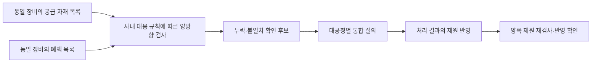
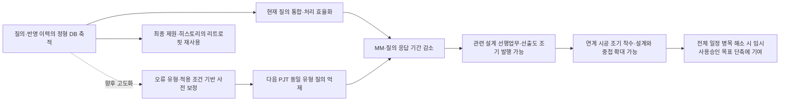
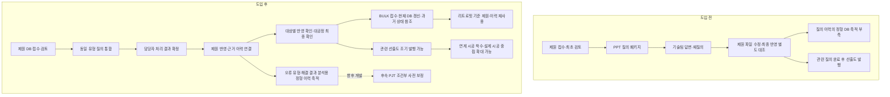

# 제원 질의 데스크 사내 특허 제안서 — 지정양식 v7

작성일: 2026-10-22

본 문서는 사용자 지정 10개 항목을 유지하고, **PPT로 주고받던 제원 질의·답변을 정형 DB로 축적하고 실제 최종 반영까지 연결하여, 후속 PJT와 리트로핏에 재사용하는 데이터 기반을 만드는 것**을 강조한 검토본이다. 답변 완료와 실제 반영 완료의 구분은 현재의 핵심이며, 축적된 오류 유형·해결 이력을 통한 후속 PJT의 질의 사전 해소 및 자동 제원 보정은 향후 고도화이다. 질의 단축에서 선출도 조기 발행·시공 중첩·임시사용승인 목표시점 단축으로 이어지는 효과는 단계별 조건을 구분하여 설명한다. 정량 효과는 시험 목표이며 신규성·진보성 및 출원용 청구범위 검토는 완료되지 않았다.

## 1. 발명의 서지정보

### 1.1 발명의 명칭

**제원 질의 처리 이력의 정형화 및 최종 반영 확인을 이용한 반도체 설비 제원 데이터 관리 방법 및 시스템**

영문명: Method and System for Managing Semiconductor Equipment Specification Data Using Structured Query Processing Histories and Final Incorporation Verification.

### 1.2 발명 핵심 키워드

제원 질의·답변 정형 DB, 최종 제원 반영 확인, 오류 유형 분석, 확정 결과 재사용, 대공정별 통합 처리, 변경 이력, 리트로핏, 향후 자동 제원 보정, 선출도 조기 발행, 설계·시공 중첩.

### 1.3 외부 공동출원인 여부

**확인 필요.** 외부 공동출원 약정 및 발명 기여 관계를 확인하지 않았다. 설계사·협력사가 업무에 참여하거나 유량 기준을 협의했다는 사실만으로 공동출원 여부를 확정하지 않는다. 발명자 및 출원인 표기는 사내 확인 후 기재한다.

### 1.4 논문·학회 발표 등 외부 공개 및 예정 여부

| 구분 | 현재 확인 내용 |
|---|---|
| GitHub 공개 | 사용자 요청에 따라 2026-10-22 공개 저장소에 특허 초안과 선행조사 보고서를 게시함 |
| 플랫폼 코드 공개 | 공개 GitHub 저장소를 참고하여 작성함. 코드의 최초 공개일과 당시 공개 범위는 별도 확인 필요 |
| 논문·학회·외부 발표 | 실시 여부 및 예정일 미확인 |
| 기타 외부 공유 | 원문 아티팩트 등 다른 경로의 공개 범위·최초 공개일 미확인 |

본 문서가 미공개 초안이라는 전제로 기재하지 않는다. 공개 경위·시점·당시 내용을 사내 특허 담당자에게 전달하여 출원 검토에 반영한다.

### 1.5 선행기술자료

대표 비교자료는 [CN111859479B](https://patents.google.com/patent/CN111859479B/en)와 [US7054885B1](https://patents.google.com/patent/US7054885B1/en)이다. 확인 범위와 차이점은 2절에 기재한다.

| 구분 | 자료 및 공개 정보 | 관련 사항 |
|---|---|---|
| P1 | [CN111859479B](https://patents.google.com/patent/CN111859479B/en), B공보 2024-02-20, A공보 2020-10-30 | PDM의 설계 변경·승인·버전 및 차이 저장 |
| P2 | [US7054885B1](https://patents.google.com/patent/US7054885B1/en), 2006-05-30 | 설계 구성항목의 버전·변경 패키지·병합과 해결 기록 |
| P3 | [US20190332699A1](https://patents.google.com/patent/US20190332699A1/en), 2019-10-31 | DB 충돌 표시 및 해결 선택, 세 버전 병합 |
| P4 | [US20130262419A1](https://patents.google.com/patent/US20130262419A1/en), 2013-10-03 | 구조 의미·규칙에 따른 비교 및 병합 |
| P5 | [KR20050069985A](https://patents.google.com/patent/KR20050069985A/en), 2005-07-05 | 건설 구성요소 식별자·상태·관련 파일의 DB 연결 |
| N1 | [Khanna 등, A Formal Investigation of Diff3, 2007](https://www.cis.upenn.edu/~sanjeev/papers/fsttcs07_diff3.pdf) | 공통 기준 상태와 두 파생 상태를 비교하는 기존 기법 |
| N2 | [W3C PROV-O, 2013](https://www.w3.org/TR/2013/REC-prov-o-20130430/) | 데이터·활동·책임 주체 및 파생 관계 표현 |
| N3 | [buildingSMART BCF 3.0 기술문서](https://github.com/buildingSMART/BCF-XML/blob/release_3_0/Documentation/README.md) | 설계 이슈·담당자·문서·답변 연결 |

GCS 후보의 인접 자료로 [EP1078887A1](https://patents.google.com/patent/EP1078887A1/en)의 CMP 폐수 처리, [CN107705235A](https://patents.google.com/patent/CN107705235A/en)의 폐기물 속성·호환관계 DB, [Systematic Waste Minimization in Chemical Processes. 2. Intelligent Decision Support System](https://pubs.acs.org/doi/10.1021/ie0102089)의 폐기물 발생원 분석을 검색하였다. 이들 자료가 본 제안의 장비 단위 양방향 제원 검증과 동일하다고 판단한 것은 아니다.

상세 범위: [선행특허·참고문헌 1차 조사 보고서](제원질의데스크_선행특허_참고문헌_1차조사.md). 국내 일부 자료는 검색 결과에 재현된 공보 내용, 논문 일부는 초록 확인에 한정한다. 등록 청구항·패밀리·사내 비공개 출원의 전체 조사는 미완료이다.

### 1.6 당사 제품 적용 계획

| 항목 | 기재 내용 |
|---|---|
| 직접 적용 대상 | 삼성전자 반도체 신축 및 리트로핏 PJT의 제원 검토·질의·변경 관리용 사내 플랫폼 |
| 플랫폼 명칭 | 제원 질의 데스크 / 제원관리 플랫폼 |
| 당사 제품 모델명 | 미확정. 특정 반도체 제품·설비 모델에 적용된다는 정보는 확인되지 않음 |
| 제품 출하시기 | 미정 또는 해당 여부 확인 필요. 현재는 사내 업무 시스템이며 외부 출하 제품으로 확정되지 않음 |
| 현장 시험 계획 | 2026-10-21 사용자 설명 기준 약 1개월 반 후 시험 적용 계획. 정확한 적용 PJT·일정은 미확정 |
| 개발 단계 | 정식 운영 전 데모 |

P4·P5는 향후 프로젝트 간 비교 예시이며 적용 PJT나 제품 모델로 확정한 명칭이 아니다. 제품 모델·출하시기를 임의로 대입하지 않는다.

## 2. 대표 선행기술 VS 본 발명의 차이점

### 2.1 대표 선행기술 P1과의 비교

대표 선행기술: CN111859479B, Engineering change full life cycle management method and system in PDM system. B공보의 설명과 청구항 1 등을 확인하였다. 청구 구성에는 기술 파라미터 제약관계, 변경 승인·버전 결과 및 정규화 후 차이 계산이 포함된다. A공보와 B공보의 전 문언 대조는 미수행이다.

| 비교 항목 | 대표 선행기술 P1 | 본 발명에서 구체화하는 내용 |
|---|---|---|
| 목적 | 설계 변경에 따른 기술 파라미터·절차의 연계 관리 | 질의 답변의 실제 최종 제원 반영을 확인하고, 처리 경험을 후속 PJT·리트로핏에 활용 |
| 구성요소 | 설계 노드·제약 규칙·변경 승인·결과 버전·차이 DB | 질의별 장비·대상 항목·오류 유형·확정 조치·실제 반영·적용 조건·시점의 정형화된 연결 |
| 효과 | 변경에 따른 반복 소통 감소 및 협업 효율 향상이라는 취지 | 미반영 식별과 최종본 대조 부담 감소, 반복 오류 분석·재사용을 위한 기반 형성 기대 |
| 차이점 | 변경 승인 및 변경 결과의 버전 관리 구조 | 질의 대상별 반영 판정과 실제 적용된 해결 결과를 함께 축적하여 다음 업무에 재사용하는 구조를 구체화 |

확인한 문헌에 질의 대상별 반영 확인 구성 전체가 없다고 단정하지 않는다. 위 내용은 실제 구성 대조를 위한 비교 방향이다. ‘반도체에 적용’, ‘DB로 저장’만을 차별점으로 삼지 않는다.

### 2.2 대표 선행기술 P2와의 비교

대표 선행기술: US7054885B1, Method and system for managing the configuration of an evolving engineering design using an object-oriented database. 변경 패키지 및 병합 예시와 청구항 1 등을 확인하였다.

| 비교 항목 | 대표 선행기술 P2 | 본 발명 및 추가 설계안 |
|---|---|---|
| 목적 | 병행 설계 변경의 보존·병합 및 구성 관리 | 확정 질의 결과가 실제 제원에 적용됐는지 확인하고 후속 전체본의 미반영 후보 식별 |
| 구성요소 | 구성항목·변경 시작 상태·변경 패키지·해결 기록 | 질의별 확정 결과와 항목별 적용 이력, 작성 기준본·질의 반영본·신규본, 대공정별 확인 질의 |
| 효과 | 변경 손실을 줄이고 상충 변경 해결 지원 | 질의 수정분의 되돌림·미반영 후보 구분과 실제 반영 변경량의 오집계 감소 기대 |
| 차이점 | 일반적인 병합과 사용자 해결 기록 | 질의 완료·실제 반영의 업무 의미를 이용해 후보를 분류하고 대상별 재확인에 연결하는 구조 |

세 상태 비교 및 해결 기록 자체는 기존 기술이다. 후속 전체본 처리와 GCS 정합성 검증은 추가 설계안이며, 구현 또는 선행기술 대비 권리성이 확인된 것으로 표현하지 않는다.

### 2.3 GCS 후보의 차별화 방향

기존에 검색된 폐수 처리·폐기물 호환성 판단과 구분하여, **같은 장비의 공급 케미컬·슬러리 제원과 폐액 제원을 양방향 대조하고, 불일치 질의를 처리한 뒤 양쪽 제원의 실제 반영을 재확인하는 연결 구조**를 조사한다. 복수 자재가 하나의 폐액에 대응할 수 있다는 점을 반영한다. 구체적인 매핑표와 필수·허용 조건은 추후 사용자 코멘트로 확정한다.

### 2.4 실제 현행 업무 대비 변화 — 선행특허 비교와 구분

| 항목 | 기존 현행 업무 | 플랫폼 적용 방향 |
|---|---|---|
| 질의·답변 | 설계사가 PPT로 제원 질의, 각 공정별 기술팀이 검토·답변 | 장비·항목·담당자에 연결된 질의 처리 |
| 이력 보존 | PPT 기록은 존재하더라도 질의·답변이 정형 DB로 축적되지 않음 | 질의·오류 유형·확정 조치·실제 반영·시점을 DB로 축적 |
| 데이터 활용 | 개별 파일을 다시 찾아 해석해야 함 | 오류 유형·발생 조건·처리 결과의 조회·분석 및 재사용 |
| 후속 PJT | 같은 유형의 질의를 다시 수행 | 향후 검증된 적용 조건에 맞는 제원은 사전 보정하여 같은 질의 발생 억제 |
| 후속 공사 | 최종 제원과 변경 근거를 재확인 | 질의 결과가 반영된 최종 제원 및 이력을 리트로핏 검토에 활용 |

위 표는 사용자가 설명한 현행 업무와의 비교이다. 사내에서 DB를 새로 구축했다는 사실이 특허 선행기술 전체에 대해 신규성을 입증하는 것은 아니며, 정형화되는 항목과 실제 반영 연결 및 재사용 처리의 구체적인 결합을 검토한다.

## 3. 발명의 상세한 내용

### 3.1 배경기술·종래기술 문제점 및 발명의 목적

현행 업무는 제원 접수 후 설계사 최초 검토 약 1주, PPT 질의 패키지 발행, 제조 기술팀과 답변 왕복 최소 5근무일 이상, 재질의 및 후속 패키지로 진행된다. 프로젝트당 패키지는 약 10회 이상이다. 최초 검토 1주와 별도로 질의·검토 기간은 약 2개월이다.

대표 프로젝트 규모는 장비 약 1,500대이며 개별 질의는 약 300~400건 예상이다. 설계사·협력사 약 120명, 삼성전자 담당자 약 50명이 참여할 것으로 예상된다. 패키지와 개별 질의를 구분하며, 참여 인원은 전담 투입인원이 아니다.

기존에는 설계사가 PPT로 질의를 제기하고 각 공정별 기술팀이 답변을 검토했다. 이 질의·답변 및 판단 과정이 정형 DB로 남지 않아, 해결 경험을 장비·항목·오류 유형별로 분석하고 다음 PJT에서 재사용할 기반이 부족했다. PPT 파일의 보관과 분석 가능한 이력 DB의 축적은 구분된다.

또한 질의·답변이 제원 데이터와 분리되어 답변 완료가 실제 제원 반영 완료를 뜻하지 않았다. 복수 대상 중 일부만 수정되거나 후속 변경 접수로 수정값이 되돌아갈 수 있고, 담당자가 확인한 최종 제원을 찾기 어렵다.

사용자 설명상 일부 선출도 도면은 관련 제원 질의가 끝나야 발행할 수 있다. 선출도는 공식 AFC 도면 발행 전에 나가는 도면을 뜻한다. 따라서 해당 범위의 질의 지연은 선출도 발행과 연계 시공 착수의 지연으로 이어질 수 있다. 모든 도면이나 모든 공사의 착수 조건을 동일하게 전제하지 않는다.

본 발명의 목적은 질의·답변·오류 유형·확정 결과·실제 반영을 정형 DB로 축적하고, 최종 제원 및 변경 근거를 확인 가능하게 하며, 동일 유형 질의를 통합하여 MM과 응답 기간을 줄이는 것이다. 축적된 이력은 후속 PJT의 반복 오류 분석 및 향후 자동 보정, 리트로핏의 기존 제원·변경점 검토에 재사용한다. 질의 기간 단축을 선출도 조기 발행 및 설계·시공 중첩 확대에 연결하는 것을 기대한다.

### 3.2 핵심 아이디어 요약

장비·제원 항목을 중심으로 질의 내용, 오류 유형, 기술팀 답변, 확정 조치, 실제 반영 결과, 적용 조건 및 시점을 연결한 정형 레코드를 만든다. 단순 문서 첨부를 넘어 ‘어떤 조건의 오류를 어떤 판단으로 해결했고 실제 제원에 어떻게 반영했는가’를 분석할 수 있는 백데이터를 축적하는 것이다.

그 안에서 ‘답변이 등록되었음’과 ‘답변에서 확정한 조치가 각 대상 제원에 반영되었음’을 별도로 관리한다. 제원을 변경하는 질의에는 확정값·추가·삭제 등의 기대 상태를 연결하고 처리 후 실제 상태와 비교한다. 최종 확인 시점과 현재 시점도 구분하여 후속 변경을 과거 질의 미처리와 혼동하지 않도록 한다.

향후에는 실제 반영까지 확인된 해결 결과와 적용 조건을 오류 유형별로 정리하여, 다음 PJT의 같은 조건에 해당하는 제원을 질의 전에 보정하는 방향으로 고도화한다. 반복 횟수만으로 무조건 자동전환하지 않고 검증된 조건·예외·정책을 갖춘 유형을 대상으로 한다. 현재 이 고도화의 규칙 확정 및 운영 검증은 완료되지 않았다.

이 판정·시점 연결은 기존 데모의 질의·변경 이력 연계를 특허 설명에 맞게 구체화한 설계이다. 모든 상태 표시나 비교 기능이 현재 데모에 구현됐다는 뜻은 아니다.

### 3.3 발명이 적용되는 장치

설계사·기술팀 담당자의 단말, 제원·질의 데이터를 처리하는 컴퓨터 및 데이터 저장장치에 적용한다. 웹 서버와 DB를 사용하는 형태 또는 브라우저에서 공유 저장소를 이용하는 형태로 구현할 수 있다. 반도체 생산장비 제원을 다루는 정보처리 시스템이며, 현재 설명은 장비의 실제 밸브·배관을 직접 제어하는 구성을 요구하지 않는다.

## 4. 발명에 대한 상세한 설명

### 4.1 관리 정보와 연결 관계

| 정보 | 내용 및 관계 |
|---|---|
| 장비 정보 | PJT·건설코드·대공정, 설비 유형 구분용 PRC·MODEL·MAKER |
| 제원 항목 | UT 분류·성상·모듈 및 유량·압력·전력 등 해당 항목의 값 |
| 질의 | 대상 항목 집합, 질의 유형, 담당 대공정, 답변 및 처리 단계 |
| 확정 결과 | 유지·값 수정·추가·삭제 등의 조치, 기대 상태, 확정자·시점 |
| 반영 이력 | 실제 반영 대상, 전후 상태, 근거 질의, 적용 시점, 복원 참조 |
| 분석용 처리 이력 | PJT·장비 유형·항목·오류 유형·검토 조건·확정 답변·조치·실제 반영 결과를 연결한 정형 기록. 현 데모 이력의 구체화 및 확장 설계 포함 |
| 최종 확인 | 대공정 담당자·확인 시점·확인 범위 및 해당 시점의 제원 상태 |
| GCS 규칙 | 같은 장비의 공급 자재와 폐액 사이 필수·허용·조건부 관계 — 추가 설계 |

장비 유형이 같아도 개별 장비는 건설코드로 구분한다. 동일 코드 내 반복 UT 항목을 연결하는 안정적인 기준은 실제 제원 양식에 맞춰 정한다. 엑셀 행 번호나 성상명 하나만으로 중복 항목을 연결하지 않는다.

### 4.2 질의 통합 및 처리

검토 규칙에 따라 대상 항목을 식별하고, 대공정·질의 유형·대상 항목 종류·동일 처리 가능 조건에 따라 묶는다. 동일한 값을 일괄 반영할 때에는 적용 조건과 제안값이 같은지 구분한다. 질의 하나에 연결된 여러 대상의 실제 반영은 대상별로 확인한다.

추천값은 명확한 협의 기준이나 규칙이 있는 경우 제공한다. 폐수·WATER·B.GAS의 노즐 사이즈별 유량표는 전자·삼우설계 협의의 추천·검토 기준이며, 초과만으로 등록·반영을 차단하거나 기준값으로 강제 변경하지 않는다. 전기 피상전력 검토 및 IGPM·DS-EHS 자재명 연결의 세부 규칙은 추가 확인한다.

### 4.3 질의 결과의 실제 반영 확인 — 핵심 구성

1. 질의가 가리키는 대상 항목과 확정 조치를 저장한다.
2. 제원 수정이 발생하면 실제 대상·변경 전후 상태·근거 질의를 연결한다.
3. 조회 기준 시점의 실제 제원과 확정 조치의 기대 상태를 대응시킨다.
4. 질의의 답변 상태와 실제 반영 결과를 구분하여 제공한다.
5. 복수 대상 중 미반영·부분 반영 항목을 식별하여 재확인할 수 있게 한다.

다음은 반영 판정의 설계 예이다. 실제 화면의 상태명 또는 구현 완료 사실을 뜻하지 않는다.

| 상황 | 판정·표시 예 |
|---|---|
| 답변 등록, 처리 결과 미확정 | 답변 완료 / 확정 대기 |
| 수정값 확정, 실제 반영 이력·값 미충족 | 미반영 또는 확인 필요 |
| 질의 대상 일부에만 수정 적용 | 부분 반영, 미반영 대상 목록 |
| 확정 조치와 반영 결과·조회 상태가 일치 | 해당 시점 반영 확인 |
| 기존값 유지로 확정, 실제값도 유지 | 유지 조치 반영 확인 |
| 제원 변경이 필요 없는 설명 질의 | 처리 종결, 값 변경 판정 대상 아님 |
| 과거 정상 반영 후 후속 BULK 변경으로 값 변동 | 과거 반영 확인 / 이후 변경 있음 |

현재값이 기대값과 같다는 이유만으로 과거 질의가 실제 반영되었다고 단정하지 않도록, 값의 일치와 근거 반영 이력을 함께 확인하는 구성을 제안한다. 직접 질의 참조가 없는 변경은 확인 필요로 구분하거나 담당자 확인을 기록하는 변형이 가능하다.

질의 반영 시점의 값과 현재값을 구분한다. 이후 정당한 변경이 있었다면 과거 반영 실적을 삭제하거나 현재 차이를 곧바로 과거 미반영으로 판단하지 않는다.

### 4.4 최종 제원 확인과 이력 복원

BULK 변경 전 특정 시점에 대공정 기술팀 담당자가 ‘해당 제원을 확인했고 변경 접수 전 최종 제원으로 인정한다’는 절차상 확인을 남긴다. 후속 변경 접수를 허가하는 결재 게이트나 데이터 잠금이 아니다.

별도 결재본 파일 복제를 필수로 하지 않고 기존 단계 복원 기능과 확인 시점의 관계를 이용한다. 확인자·확인시점·대상 범위를 조회 가능한 과거 상태와 연결하는 세부 구조는 추가 설계이다. 불변 저장·영구 보존이 구현되었다고 전제하지 않는다.

### 4.5 추가·삭제·변경의 간단 정의

| 대표 구분 | 정의 |
|---|---|
| 추가 | 기존에 없는 건설코드 발생 |
| 삭제 | 신규 PJT 전체본에서 기존 건설코드 소멸 |
| 변경 | 동일 건설코드 안의 UT 추가·삭제·성상 또는 제원값 변동 |
| 유지 | 건설코드·UT 구성·관리 대상 제원값 모두 동일 |

동일 장비의 코드 변경이 확인되면 ‘변경—건설코드 변경’으로 연결할 수 있다. 대응표·확인 근거가 없으면 기존 코드 삭제와 신규 코드 추가 후보로 분류한다. 코드의 삭제·추가를 실제 철거·설치로 단정하지 않는다.

### 4.6 BULK 전체본의 변경 반영

수십~수백 대에 걸친 변경을 포함하는 자료를 접수한다. 비교 범위는 해당 PJT 전체 제원이다. 변경 표시본은 추가·삭제·수정 표시의 의미를 해석하고, 미표시 전체본은 기존 DB와 건설코드 및 값 차이를 비교한다. 변경량을 산출하여 별도 변경 결재를 기다리지 않고 현재 DB에 반영한다. 입력 읽기 실패를 정상 누락·삭제로 취급하지 않는다.

이전 단계 복원·수정은 사용자 확인상 구현되어 있다. 변경량 산출·덮어쓰기도 구현 완료이나, 항목별 모든 예외 처리가 시험되었다는 뜻은 아니다.

### 4.7 과거 질의 수정과 신규 변경 구분 — 추가 설계

신규본의 작성 기준 상태를 B, 질의 반영 후 최종 상태를 Q, 신규 접수 상태를 N으로 둔다. B는 최초 접수본으로 고정하지 않고 실제 작성 기준을 지정한다. B가 미확정이면 분류도 확인 필요로 제공한다.

| 비교 | 의미·처리 후보 |
|---|---|
| B=Q=N | 유지 |
| B≠Q, N=Q | 질의 확정값의 신규본 반영, 중복 변경 집계 제외 |
| B≠Q, N=B | 과거 질의 미반영 또는 의도적 되돌림 후보 |
| B=Q, N≠B | 과거 질의 수정과 충돌하지 않는 신규 변경 후보 |
| B≠Q이고 N이 둘과 다름 | 질의 확정값과 신규값의 충돌 후보 |

예를 들어 기준 유량 100, 질의 확정값 60, 신규본 100은 ‘미반영’과 ‘100으로 재변경’을 값만으로 구분할 수 없다. 관련 질의·적용 이력을 제시하고 담당자에게 의도를 확인한다. UT 존재·부재도 동일 원리로 비교한다.

일반 세 상태 비교는 기존 문헌의 기법이다. 본 추가안은 그 결과를 실제 질의 이력과 연결하여 후보를 통합 질의화하고, 접수 차이·미확정 후보·실제 반영 변경량을 분리하는 구성이다. 접수 원본 즉시 등록을 유지하되 충돌 항목의 현재값 반영만 보류하는 정책은 제안 단계이며 사용자 확정 전이다.

### 4.8 GCS 케미컬·슬러리와 폐액의 양방향 검증 — 추가 후보

검증 단위는 동일 장비이다. 복수 공급 자재가 하나의 폐액에 대응할 수 있다. 다른 장비의 자재를 끌어와 해당 장비의 누락을 보완하지 않는다.

공급 자재에서 필요한 폐액의 존재·적합성을 검토하고, 등록 폐액에서 대응 가능한 공급 자재가 해당 장비에 있는지 역방향으로 확인한다. 관계는 일대일로 가정하지 않으며, 후보 중 하나가 존재하면 되는지 복수 조합이 필요한지는 실제 규칙으로 정한다. ‘허용 관계’를 ‘모두 필수’로 오해하지 않도록 구분한다.

구체적인 실제 매핑 사례와 구현 여부는 사용자 추후 코멘트 대기 상태이다. IPA·SB-870·ACT-945 등을 특정 폐액으로 확정 매핑하지 않으며, 실제 성상·농도·사내 기준 확인 없이 혼합 배출 적합성을 의미하도록 서술하지 않는다.

### 4.9 정형 이력의 축적·분석 및 후속 PJT 재사용

현재 목표는 최종 제원과 질의·수정 이력을 DB로 관리하는 것이다. 이 데이터를 활용한 분석·재사용의 구체화안은 다음과 같다.

| 축적 항목 | 활용 방향 |
|---|---|
| 장비 유형·UT·대상 항목·오류 유형 | 반복되는 오류와 질의 발생 조건 분석 |
| 답변·확정 조치·전후 값·실제 반영 결과 | 단순 답변과 실제 적용된 해결 결과 구분 |
| 적용 조건·예외·유지 판단·반려 사유 | 다른 조건의 장비에 잘못된 수정값을 적용하는 것을 줄임 |
| PJT·담당 대공정·처리 시점·왕복 내역 | 처리 부담과 반복 업무 분석 |
| 최종 확인 시점·이후 변경 이력 | 당시 기준 제원과 현재 제원을 구분하여 재사용 |

향후 자동 보정에서는 적용 가능한 것으로 검토된 유형·조건을 저장하고, 새 PJT 입력을 대조하여 같은 조건에서의 보정 결과를 산출한다. 규칙에 포함되지 않은 대상, 상충 이력 또는 예외 조건은 일반 질의로 처리한다. 보정 결과도 검증·반영 이력을 남겨 다음 분석에 연결한다. 상세 승인 정책은 향후 정하며 현재 자동 보정 완료 기능으로 주장하지 않는다.

특히 권고 유량 초과처럼 유지가 가능한 유형은 과거 보정값을 기계적으로 적용하지 않는다. 적용 조건이 같고 사전에 정한 보정 정책을 충족할 때에만 자동 처리 대상으로 삼는 방향이다. 목표는 조건이 명확한 동일 유형 질의의 재발 억제이며 모든 제원 질의의 완전 제거가 아니다.

### 4.10 리트로핏에서의 최종 제원·히스토리 활용

신축 PJT에서 질의 결과를 반영한 최종 제원과 후속 변경 이력을 리트로핏의 검토 기준으로 참조한다. 기존 장비의 공급·배출 제원, 확정 사유 및 변경 시점을 조회하고 새 접수 제원과 비교하여 변경량과 추가 확인 대상을 산출하는 방향이다.

당시 확정 제원과 실제 현장이 이후에도 항상 같다는 의미는 아니다. 리트로핏 기준 시점을 정하고 후속 변경의 반영 범위를 확인하여 사용한다. 공급 여유량·배관 용량 및 대응 가능 여부 자동 판정은 추가 데이터와 규칙이 필요한 장기 확장이다.

## 5. 아이디어의 변형 또는 회피에 따른 다양한 실시예

다음은 특정 화면·파일·저장 방식에 의존하지 않고 핵심 연결을 구현하는 변형안이다. 실제 청구범위의 포섭 여부를 확정한 것은 아니다.

| 실시예 | 변형 구성 | 공통으로 유지할 핵심 |
|---|---|---|
| A. 서버형 | 사용자 단말·서버·관계형 DB로 처리 | 질의 대상·결과·실제 반영·시점 연결 |
| B. 브라우저형 | 브라우저와 공유 저장소로 처리 | 같은 연결과 반영 확인을 제공 |
| C. 개별·묶음 처리 | 같은 유형을 묶거나 대상별로 처리 | 복수 대상의 반영은 각각 확인 |
| D. 결과 표현 | 화면 배지 대신 보고서·목록·알림으로 제공 | 답변 완료와 반영 결과를 별도 제공 |
| E. 이력 참조 | 변경 차이 누적·과거 상태 참조·시점별 기록 등으로 복원 | 조회 기준 시점과 현재값의 차이 구분 |
| F. 입력 형식 | 엑셀·표준 파일·외부 데이터 연계 | 대상 식별과 질의 반영 관계 유지 |
| G. 변경 대상 | 값 수정뿐 아니라 UT 추가·삭제·유지 처리 | 조치별 기대 상태와 실제 상태 대조 |
| H. 후속 전체본 | 표시본 또는 무표시 전체본 | 접수 형식을 해석한 변경 내역과 이력 연결 |
| I. 코드 변경 | 코드 유지, 확인된 코드 변경, 대응 불명확의 세 경우 | 개체 확인 근거와 단순 유형 일치 구분 |
| J. GCS 규칙 | 단일 대응·복수 후보·조건부 조합 | 장비 단위 공급·폐액 양방향 검사 후 반영 확인 |
| K. 적용 현장 | 신축 또는 리트로핏 | 최종 제원과 후속 변경의 공통 관리 |
| L. 후속 PJT 사전 보정 | 검증된 오류 유형·해결 결과·적용 조건을 신규 제원에 대조 — 향후 개발 | 실제 반영 근거를 이용한 조건부 보정과 예외의 질의 전환 |

구체 실시예 1: 한 질의에서 20개 항목의 수정값을 확정했으나 18개만 실제 적용되면 질의를 단순 완료로만 표시하지 않고 미반영 2개를 구분한다. 수치는 작동 설명용 가정이다.

구체 실시예 2: 질의로 UT 항목 삭제가 확정되면 현재 제원에서 부재하는지와 삭제 이력을 확인한다. 기존값 유지가 확정되면 불필요한 변경을 요구하지 않고 유지 상태를 확인한다.

구체 실시예 3: 질의 확정값이 한때 정상 반영된 후 BULK 변경으로 다른 값이 들어오면 ‘이전 반영 완료’와 ‘후속 변경 있음’을 구분한다. 과거 질의를 소급하여 미반영으로 바꾸지 않는 설계이다.

구체 실시예 4: 익명 자재 A·B가 동일 폐액 X의 허용 후보인 경우, 장비의 등록 자재 목록과 실제 규칙 조건을 대조한다. A·B가 모두 필수인지는 별도 규칙으로 판단한다. 실제 사내 매핑을 공개한 예가 아니다.

구체 실시예 5 — 향후 고도화: PJT A에서 오류 유형과 적용 조건이 확정되고 실제 반영까지 확인된 경우, PJT B의 같은 조건에 해당하는 제원에 검증된 보정 규칙을 적용하여 같은 질의를 반복하지 않도록 한다. 조건이 다르거나 상충 이력이 있으면 자동 적용하지 않고 질의 대상으로 분리한다. 실제 구현·성과로 주장하지 않는다.

구체 실시예 6 — 리트로핏: 기존 PJT의 최종 확인 제원과 이후 변경 내역을 기준 시점까지 조회하고, 리트로핏 접수 제원과 대조한다. 기존 제원을 매번 PPT·과거 파일에서 재구성하는 부담을 줄이는 용도로 사용한다.

향후 REV 0.0·1.0 비교, P4·P5 등 PJT 총량 비교 및 오류 이력 기반 자동변환으로 확장할 수 있다. REV·PJT 비교는 구현 예정, 자동설계·대응 가능 여부 판단은 장기 목적이다.

## 6. 설명에 사용한 용어·약어 정리

| 용어 | 본 문서에서의 의미 |
|---|---|
| 제원 | 장비별 공급·배출·전기 등 설계에 필요한 사양 데이터 |
| 최종 제원 | 특정 시점에 대공정 담당자가 BULK 변경 전 최종 상태로 확인한 제원 |
| 현재 제원 | 후속 변경을 포함하여 현재 DB에서 조회되는 값 |
| 반영 확인 | 확정된 조치와 실제 적용 이력·대상 상태의 대응 확인 |
| 정형 DB·백데이터 | 장비·항목·오류 유형·답변·확정 조치·실제 반영·시점 등을 정해진 관계로 저장하여 조회·분석·재사용하는 데이터 기반 |
| 선출도 도면 | 사용자가 설명한 공식 AFC 도면 발행 전에 나가는 도면. 관련 제원 질의 완료가 발행 조건인 범위에서 효과를 검토 |
| AFC 도면 | 본 문서에서 공식 공사용 도면을 가리키는 사용자 용어. 사내 발행·승인 기준은 별도 확인 |
| 리트로핏 | 기존 설비·시설의 변경·개조 공사와 이에 수반되는 제원 검토 |
| 임시사용승인 시점 | 사용자가 제시한 PJT의 후속 목표 일정. 본 문서는 법적 승인 요건이 아닌 일정 연계 효과를 다룸 |
| 건설코드 | PJT 내 개별 장비를 식별하는 코드 |
| PRC·MODEL·MAKER | 같은 설비 유형을 판단하는 세 정보. PRC의 정식 명칭·코드 의미는 미확정 |
| 대공정 | 장비 제원 및 담당 기술팀의 업무 구분 단위 |
| UT | 유틸리티. 본 문서는 제원표의 공급·배출 성상 및 관련 항목을 포함하여 사용 |
| 케미컬·슬러리 | 장비에 공급되는 약액·슬러리 자재. 사용 후 배출 폐액과 구분 |
| 폐액 | 장비에서 배출되는 액상 폐기 대상. 상세 분류는 사내 기준에 따름 |
| GCS | 본 플랫폼에서 관련 가스·케미컬·폐액 검토를 다루는 업무 명칭. 정식 영문 확장명은 미확인 |
| IGPM | 사용자 설명상 설계·운영 기준 자재명을 사용하는 시스템. 정식 확장명 미확인 |
| DS-EHS | 사용자 설명상 제원표 자재명과 관련된 기준·시스템 명칭. 정식 확장명 미확인 |
| B.GAS | 사용자 제원 분류 명칭. 정식 확장명 및 세부 범위 미확인 |
| PJT / REV | 프로젝트 / 리비전 |
| BULK 변경 | 여러 장비의 변경을 묶어 접수하는 변경자료 |
| DB / PPT | 데이터베이스 / 현행 질의 패키지를 작성하는 프레젠테이션 자료 |
| MM | Man-Month, 사내 월 근로시간 기준으로 환산한 실작업 투입량 |
| B / Q / N | 신규본 작성 기준 상태 / 질의 반영 후 최종 상태 / 신규 접수 상태 |
| 정합성 | 해당 장비의 제원 항목들이 설정된 대응 조건을 충족하는 상태 |
| 필수·허용 관계 | 반드시 존재해야 하는 대응 / 존재할 수 있는 대응. 서로 구분함 |

## 7. 희망하는 청구 범위

핵심 권리화 희망 대상은 질의·답변·확정 조치·실제 반영을 항목별·시점별 정형 이력으로 연결하여 확인하고, 처리 경험을 분석·재사용할 수 있게 하는 구조이다. 일정 단축은 기술 적용의 기대 효과로 설명하며 공사 일정 자체를 핵심 정보처리 구성 대신 청구하지 않는다. 아래 문언은 기술 검토 초안이며 확정 출원 청구범위가 아니다. 실제 구현 범위, 선행기술 및 발명 기여에 따라 조정한다. GCS는 추가 고안으로 분리 검토할 수 있도록 별도 독립항 후보를 둔다.

### 청구항 1 — 최종 반영 확인 방법

컴퓨터에 의해 수행되는 반도체 설비의 제원 데이터 관리 방법에 있어서,

개별 설비의 식별정보에 대응하는 제원 항목과, 상기 제원 항목을 대상으로 하는 질의의 식별정보를 연결하여 저장하는 단계;

상기 질의의 처리 결과로 확정된 대상별 조치와, 상기 조치에 따른 기대 제원 상태를 저장하는 단계;

상기 대상별 조치의 실제 적용 결과를 대상 제원 항목, 적용 시점 및 근거 질의와 연결한 반영 이력으로 저장하는 단계;

상기 대상 제원 항목, 오류 또는 검토 유형, 질의 처리 결과 및 반영 이력을 상호 대응하는 정형 기록으로 저장하는 단계;

조회 기준 시점에 대응하는 실제 제원 상태 및 상기 반영 이력을 상기 기대 제원 상태와 대조하여 대상별 반영 여부를 판정하는 단계; 및

상기 질의의 답변 상태와 구분하여 상기 대상별 반영 여부를 제공하는 단계;

를 포함하는 제원 데이터 관리 방법.

### 청구항 2

청구항 1에 있어서, 동일 유형의 질의 대상을 대공정 및 동일 처리 가능 조건에 따라 하나의 질의에 연결하고, 상기 질의의 복수 대상 중 미반영 대상을 구분하여 제공하는 방법.

### 청구항 3

청구항 1에 있어서, 상기 대상별 조치는 값 수정, 항목 추가, 항목 삭제 또는 기존값 유지 중 적어도 하나이고, 조치 종류에 따라 값의 일치 또는 항목의 존재·부재를 대조하는 방법.

### 청구항 4

청구항 1에 있어서, 과거 적용 시점의 반영 여부와 후속 변경 이후의 현재 상태를 구분하여 제공함으로써 과거 반영 완료 및 이후 변경 여부를 함께 표시하는 방법.

### 청구항 5

청구항 1에 있어서, BULK 변경 전의 특정 시점에 대공정 담당자의 최종 확인 정보와 해당 시점의 제원 상태를 연결하여 저장하고, 후속 변경 후에도 상기 확인 시점을 조회 가능하게 제공하는 방법.

### 청구항 6

청구항 1에 있어서, 후속 PJT 전체 제원자료를 접수하고, 건설코드의 존재 여부 및 공통 건설코드에 속한 UT 구성·값의 차이에 따라 추가·삭제·변경을 분류하며 현재 제원을 갱신하는 방법.

### 청구항 7

청구항 6에 있어서, 상기 전체 제원자료의 작성 기준 상태와 질의 결과 반영 상태 및 신규 접수 상태를 대조하고, 질의의 확정·실제 반영 이력을 참조하여 미반영 또는 되돌림 확인 후보를 식별하는 방법.

### 청구항 8

청구항 7에 있어서, 상기 확인 후보를 담당 대공정별 질의에 연결하고, 접수본의 차이와 확인 후 실제 반영된 변경량을 구분하여 제공하는 방법.

### 청구항 9

청구항 1에 있어서, 노즐 사이즈별 협의 유량표의 기준 초과 항목을 검토 대상으로 제공하고, 기준 초과만으로 반영을 차단하지 않으며 담당자의 유지 또는 수정 결과를 저장하는 방법.

### 청구항 10

청구항 1에 있어서, 동일 장비의 공급 케미컬·슬러리와 폐액 제원을 대응 규칙에 따라 양방향으로 대조하여 질의 대상을 생성하고, 상기 질의 결과의 반영 후 양쪽 제원을 재검사하는 방법.

### 청구항 11 — GCS 정합성 검증의 별도 독립항 후보

컴퓨터에 의해 수행되는 반도체 장비의 제원 정합성 검증 방법에 있어서,

동일 장비에 대응하는 공급 자재 목록 및 폐액 목록을 취득하는 단계;

공급 자재와 폐액 사이의 대응 조건을 저장한 규칙에 따라, 공급 자재를 기준으로 폐액 제원을 검토하고 폐액을 기준으로 해당 장비의 공급 자재 제원을 검토하는 단계;

상기 검토에서 확인이 필요한 대응 항목을 질의 대상과 연결하는 단계; 및

질의 처리 결과가 반영된 공급 자재 제원 및 폐액 제원에 상기 규칙을 다시 적용하여 처리 결과의 반영 및 정합성 상태를 제공하는 단계;

를 포함하는 제원 정합성 검증 방법.

### 청구항 12

청구항 11에 있어서, 상기 규칙은 복수 공급 자재가 하나의 폐액에 대응하는 관계를 포함하고, 허용 후보의 존재 조건 또는 복수 자재의 조합 조건을 구분하여 검토하는 방법.

### 청구항 13 — 시스템

프로세서 및 명령어를 저장하는 메모리를 포함하고, 상기 명령어는 상기 프로세서에 의해 실행될 때 청구항 1 또는 청구항 11의 방법을 수행하도록 구성되는 제원 데이터 관리 시스템.

### 청구항 14 — 기록매체

컴퓨터로 하여금 청구항 1 또는 청구항 11의 방법을 수행하게 하는 프로그램을 저장한 컴퓨터 판독 가능한 기록매체.

### 청구항 15 — 이력 재사용에 의한 후속 PJT 보정의 추가 후보

청구항 1에 있어서, 실제 반영이 확인된 처리 결과의 오류 유형 및 적용 조건을 보정 규칙과 연결하여 저장하고, 후속 프로젝트의 제원이 상기 적용 조건 및 검증 기준을 충족하는 경우 보정값을 산출하여 적용하며, 조건 불일치 또는 상충 이력이 있는 항목은 질의 대상으로 구분하고, 상기 보정 결과를 실제 반영 이력에 연결하는 단계를 더 포함하는 방법.

청구항 15는 향후 자동 보정의 설계 후보이다. 구체 규칙·발명 기여·선행기술과의 차이를 추가 검토하며 현재 데모에 구현된 구성으로 표시하지 않는다.

GCS 실제 규칙, 시간별 반영 판정 및 충돌 후보 처리 등은 추가 구체화 대상이다. 별도 독립항의 출원 통합·분리 여부는 후속 검토한다.

## 8. 제품 적용 시 확인 가능 방법

### 8.1 화면·출력 및 시험을 통한 확인

| 확인 대상 | 확인 방법 | 기대되는 관찰 결과 |
|---|---|---|
| 질의와 제원 연결 | 질의에서 대상 건설코드·UT 항목을 조회 | 답변 대상과 실제 제원 항목의 대응 확인 |
| 답변과 반영 분리 | 답변만 등록하고 반영 전 상태 조회 | 답변 완료를 반영 완료로 오표시하지 않음 |
| 부분 반영 | 시험용 묶음 대상 일부만 적용 | 미반영 대상과 반영 대상을 구분 |
| 유지·삭제 조치 | 유지 및 UT 삭제 시험 | 조치별 값·존재 상태에 맞는 판정 |
| 후속 변경 | 정상 반영 후 BULK로 값 변경 | 과거 반영과 후속 변경을 구분 |
| 최종 확인 | 확인자·시점·범위와 과거 상태 조회 | 현재값과 확인 당시 값을 혼동하지 않음 |
| 변경량 | 표시본·미표시 전체본을 수동 결과와 대조 | 추가·삭제·변경 및 총량 차이의 일치 |
| 복원 | 기존 단계로 돌아가 시험 제원 확인·정정 | 이전 상태와 수정 경로 확인 |
| GCS 후보 | 익명 규칙으로 공급·폐액 누락·복수 대응 시험 | 다른 장비의 자재 없이 해당 장비만 대조 |
| 정형 데이터 축적 | 같은 오류 유형·조건의 처리 결과와 실제 반영을 조회·집계 | PPT 첨부 여부와 별개로 분석 가능한 이력 관계 확인 |
| 후속 PJT 보정 — 향후 | 규칙 적용 대상과 예외가 섞인 신규 제원으로 시험 | 조건 충족 대상만 보정하고 예외는 질의로 분리 |
| 리트로핏 재사용 | 기준 시점의 최종 제원과 후속 이력을 변경 접수본과 대조 | 기존 상태와 변경 근거의 추적 가능 여부 확인 |

이 표는 검증 계획이며 전 항목의 시험 통과를 의미하지 않는다. 실제 장비 배관·화학물질을 변경하지 않는 별도 시험 데이터로 정보처리 동작을 검증할 수 있다.

### 8.2 시스템 내부 자료로 확인

권한 내에서 질의별 대상 목록, 확정 조치, 반영 전후 값, 실제 적용 시점 및 근거 질의의 연결 자료를 확인한다. 화면의 완료 표시만으로 내부 판정 방식까지 확정하지 않고, 값의 일치와 실제 처리 기록이 일치하는지 대조한다.

GCS 기능은 실제 적용 규칙의 범위와 버전을 확인해야 한다. 사내 매핑표의 비공개성 자체를 기능 구현의 증거로 사용하지 않는다. 외부 자료만으로 관찰 가능한 범위와 내부 기록이 필요한 범위를 구분한다.

### 8.3 일정 연계 효과의 확인

관련 제원 질의의 완료일, 해당 범위 선출도 발행일, 연계 시공 착수일, 설계 완료일 및 PJT 목표 일정을 기록한다. 단축된 질의가 선출도 발행의 병목을 실제로 해소했는지 확인하고, 설계·시공 중첩 기간의 변화와 대조한다. 임시사용승인 목표 또는 실제 시점의 변화는 다른 선행작업·시공·검사 일정과 함께 판단하여 플랫폼 효과만으로 귀속하지 않는다.

## 9. 발명 적용 시 성능과 효과

### 9.1 도입 전후 효과

| 항목 | 도입 전 | 도입 후 기대 효과 | 검증 지표 |
|---|---|---|---|
| 질의 기간 | 최초 검토 1주 별도, 질의·검토 약 2개월 | 동일 범위에서 약 4주 단축 목표 | 질의 시작~종료 및 단계별 대기기간 |
| 실제 작업량 | PPT 작성·왕복·수정본 대조 반복 | 통합 처리와 DB 연결로 중복 작업 감소 | 역할별 실투입 인시·MM |
| 지식 축적 | 설계사 PPT 질의와 공정별 기술팀 답변이 정형 DB로 남지 않음 | 오류 유형·검토 조건·해결 결과·실제 반영을 분석할 백데이터 형성 | 관계가 확인된 처리 이력 수, 유형별 집계 가능 여부 |
| 다음 PJT 반복 질의 — 향후 | 과거와 같은 사안도 재질의 | 검증된 적용 조건에 따른 사전 보정으로 반복 질의 억제 | 같은 조건 대비 반복 질의 수, 보정 채택·오적용·예외 비율 |
| 반영 확인 | 답변과 제원을 수동 대조 | 질의별·대상별 실제 반영 여부 확인 | 미반영 식별률, 잘못된 완료 판정 수 |
| 최종 제원 | 최종 수정 반영본 확인 곤란 | 확인 시점과 변경 이력이 연결된 조회 | 기준 상태 검색시간·추적 가능 여부 |
| 대량 변경 | 수십~수백 대 수동 대조·취합 | 변경량 산출·DB 반영 효율화 | 수동 결과 일치율·산출시간 |
| 이력 충돌 — 설계안 | 질의 수정 누락을 신규 변경으로 오인 가능 | 미반영·되돌림 후보와 실반영량 구분 | 오분류·중복 집계·예외 처리시간 |
| GCS — 추가 후보 | 공급·폐액 항목을 각각 검토 | 장비 단위 누락·불일치 발견 후 최종 반영 확인 | 검출·오검출·처리 후 정합성 |
| 선출도 발행 | 관련 질의 완료를 기다려 발행 지연 가능 | 해당 질의가 발행 병목인 범위에서 선출도 조기 발행 기대 | 질의 완료일~발행일 및 기존 계획 대비 발행일 |
| 설계·시공 일정 | 제원 확정 지연으로 연계 도면·시공 착수 지연 가능 | 설계 선행업무 기간 감소 및 시공 조기 착수·중첩 확대 기대 | 연계 설계 완료일, 시공 착수일, 중첩 기간 |
| 임시사용승인 시점 | 선행 설계·시공 지연의 후속 일정 영향 | 관련 작업이 전체 일정의 병목인 경우 목표시점 단축에 기여 가능 | 전체 공정표 및 실제 목표시점 변화 |
| 리트로핏 활용 | 과거 최종 제원·수정 근거를 재탐색 | 최종 제원과 변경 히스토리를 DB로 조회·비교 | 기준 자료 확보·변경 검토 시간 |

기간 4주 단축은 실측 성과가 아니다. 2개월을 정확히 8주로 놓아 확정 단축률 50%라고 기재하지 않는다.

### 9.2 MM 산정

절감 MM = (도입 전 실투입 인시 − 도입 후 실투입 인시) ÷ 사내 기준 월 근로시간.

설계사·협력사 약 120명과 삼성전자 담당자 약 50명을 전담 투입인원으로 간주하지 않는다. 답변 대기 경과일과 실제 자료 작성·검토·답변·반영 시간을 분리하여 측정한다. 인건비나 인원 감축 수치는 아직 산정하지 않는다.

### 9.3 정합성과 설계 품질

유량표 기반 검토로 실제 사용 대비 과도한 입력을 재확인할 기회를 제공한다. 다만 유량 초과는 강제 오류가 아니며 배관 사이즈·공사비 절감은 실제 설계 검증 전이다. GCS 검증은 공급·폐액 제원의 정합성을 확인하는 기능으로, 실제 혼합 배출의 안전성이나 처리시설 운전 적합성까지 자동 보장하는 것으로 표현하지 않는다.

### 9.4 질의 단축에서 설계·시공 일정으로 이어지는 효과

관련 제원 질의가 종결되어야 선출도 도면을 발행할 수 있는 범위에서는, 질의 응답 기간 감소가 도면 작성·발행을 위한 선행 대기기간을 줄일 수 있다. 이는 연계 설계 업무의 완료 및 선출도 발행을 앞당기고, 해당 도면을 이용한 시공을 더 이른 시점에 시작할 기회를 제공한다. 설계기간 안에 진행할 수 있는 공사 범위가 늘면 설계·시공의 중첩을 확대할 수 있다.

이러한 작업이 PJT 전체 일정의 병목을 이루는 경우 공사 완료 및 임시사용승인 목표시점 단축에 기여할 수 있다. 다만 질의 4주 단축이 설계·공사·임시사용승인 각각의 4주 단축을 의미하지는 않는다. 도면 작성, 자재·시공 준비, 다른 선행작업 및 검사 등의 여건에 따라 전달되는 단축량이 달라진다. 단계별 절감 기간을 단순 합산하지 않는다.

### 9.5 사내 제안서에 사용할 효과 요약문

종래에는 설계사가 PPT로 제원 질의를 작성하고 각 공정별 기술팀이 답변을 검토하였으나, 질의와 해결 과정이 정형 DB로 축적되지 않아 실제 반영 여부 확인과 후속 재사용이 어려웠다. 본 플랫폼은 질의·오류 유형·확정 답변·제원 수정·실제 최종 반영 및 변경 히스토리를 연결한 데이터 기반을 마련한다. 이를 통해 현재 PJT의 반복 질의·답변 및 최종본 대조 부담을 줄이고, 향후에는 축적된 해결 노하우를 적용 조건별 보정 규칙으로 활용하여 다음 PJT에서 같은 유형의 질의가 발생하기 전에 제원을 보정하는 방향으로 고도화할 수 있다.

이러한 활용은 실투입 MM과 질의 응답 기간 감소에 기여하고, 관련 제원 확정이 필요한 설계 업무와 선출도 도면 발행을 앞당길 수 있다. 선출도 조기 발행이 연계 시공 착수로 이어지면 설계와 시공의 중첩을 확대하고 전체 일정 조건에 따라 공사 완료 및 임시사용승인 목표시점 단축에 기여할 수 있다. 또한 질의 결과가 반영된 최종 제원과 변경 이력을 리트로핏 검토에 재사용하여 기존 제원 재구성과 변경점 확인의 부담을 줄일 수 있다. 자동 보정 및 후속 일정 단축 효과는 향후 개발·실증 범위이다.

## 10. 발명 적용에 따라 발생하는 공정·설계적 변화

### 10.1 업무·설계 데이터 흐름 변화

### 10.2 변경되는 업무·설계 요소

| 요소 | 적용에 따른 변화 |
|---|---|
| 제원 접수 | 건설코드·대상 항목·원본 접수 시점의 식별 및 입력 확인 필요 |
| 질의 운영 | 패키지 전달 중심에서 제원 항목과 연결된 담당자별 처리로 전환 |
| 노하우 축적 | 공정별 답변을 파일에 남기는 방식에서 오류 유형·조건·해결 결과·실제 반영이 연결된 분석용 DB로 전환 |
| 완료 기준 | 답변 등록과 실제 반영 확인을 구분하고 부분 반영을 식별 |
| 최종 확인 | BULK 변경 전 확인자·시점·범위를 해당 제원 상태와 연결 |
| 변경 접수 | 전체본의 추가·삭제·변경 정의를 적용하고 DB 즉시 갱신 |
| 복원·정정 | 기존 단계 복원과 정정 이력을 이용해 이전 제원 참조 |
| 검토 기준 | 유량표·전기 계산·명칭 매핑의 적용 조건과 관리 책임 명확화 |
| GCS 확장 | 같은 장비의 공급·폐액을 별도 목록이 아닌 대응 관계로 검토 |
| 향후 설계 | 확정 제원 기반 REV·PJT 비교 및 자동설계 지원으로 확장 |
| 후속 PJT | 향후 검증된 적용 조건의 오류 유형을 사전 보정하여 동일 질의 재발 억제 |
| 선출도·시공 | 관련 질의 종결 시점의 단축을 선출도 발행 및 연계 시공 착수·중첩 확대에 활용 |
| 리트로핏 | 질의가 반영된 최종 제원과 그 이후 변경을 DB로 조회하여 변경 검토의 기준으로 사용 |

본 발명 적용 자체로 반도체 제조 레시피나 장비의 물리적 공정을 변경하는 것은 아니다. 배관·공급·배출 설계 변경은 플랫폼에서 확인된 제원을 근거로 별도 설계 검토를 거쳐 결정한다.

### 10.3 적용 단계와 남은 확인 사항

| 구분 | 상태 |
|---|---|
| 동일 유형 질의 통합·추천값·대공정 담당자 처리 | 사용자 확인상 데모 구현 |
| 변경량 산출·덮어쓰기·이전 단계 복원 및 수정 | 사용자 확인상 구현 |
| 대공정별 최종 제원 확인 | 운영 절차 확인, 시점별 세부 연결 구현 상태 미확인 |
| 대상별 반영 판정·후속 변경 상태 분리 | 기존 이력 연계를 구체화한 설계, 실행 검증 필요 |
| 질의 수정 미반영·되돌림 후보 구분 | 추가 설계안, 충돌 예외 반영 정책 미확정 |
| GCS 장비 단위 양방향 검증 | 장비 단위·복수 자재 대응 확인, 실제 규칙·사례·구현 여부 미확정 |
| REV·PJT 비교 | 구현 예정 |
| 정형 이력의 오류 유형 분석·다음 PJT 재사용 | DB 축적을 활용하는 방향, 구체 분석 기능·운영 성과는 별도 검증 |
| 적용 조건별 자동 보정·질의 사전 해소 | 향후 고도화, 구현·효과 확정 전 |
| 선출도 조기 발행·시공 중첩·임시사용승인 목표 단축 | 관련 업무 의존관계에 따른 기대 효과, 전체 일정 실증 전 |
| 자동설계·대응 가능 여부 판단 | 장기 목적 |

서지정보의 공동출원·외부 발표·제품 모델·출하시기, PRC 등 약어의 정식 의미, GCS 실제 규칙, 반복 UT 항목의 식별 기준 및 반영 확인 시점의 보존 범위는 추가 확인 후 확정한다. 이번 개편은 문서 재구성이며 제품 기능을 수정하거나 운영 성과를 새로 검증한 작업은 아니다.
