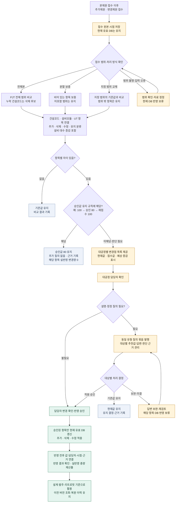

# 추가·변경제원 처리 플로우차트

확정일: 2026-10-25 | 특허초안 v11 연계

**접수는 즉시 저장하고, 현재 유효 DB는 담당자 확인·필요 질의 승인 후 갱신한다.** 아래는 확정된 업무 방향을 구체화한 설계도이며 새 절차의 구현 완료나 실행 검증을 뜻하지 않는다.

## 적용 기준

- 본제원 이후의 추가·변경 접수에 적용한다. 접수 원본과 검토 중 변경값을 설계에 사용하는 현재 유효 DB와 구분한다.
- 동일 건설코드의 다른 설비모듈에 존재하는 PCW는 별개 항목이다. 비교 식별 범위는 PJT·건설코드·설비모듈·UT 헤더·성상이다.
- 분할본의 미포함 영역은 삭제하지 않는다. 교체 범위 내 누락을 삭제로 해석하려면 해당 범위의 완전본임이 확인돼야 한다. 범위·입력이 불명확하면 해당 항목을 보류한다.
- 대표 분류에서 건설코드 추가·소멸은 장비 추가·삭제이다. 동일 코드 내 모듈·UT 추가/삭제/수정 및 대수 증감은 장비 변경의 상세 내역으로 표시한다. 한 부대설비 행 삭제를 건설코드 전체 삭제로 오인하지 않는다.
- 보충본에 이미 값이 있는 항목의 다른 값이 들어오면 자동 덮어쓰기하지 않고 변경 검토 대상으로 보낸다.
- 담당자가 변경을 확인하고 별도 질의가 불필요하다고 판단하면 반영 승인으로 진행한다. 질의가 필요한 항목은 답변·승인 후 반영한다. 구체적인 질의 대상 조건은 업무 규칙으로 관리한다.
- 100→승인 80→재접수 100은 기존 승인값 유지·추가 질의 없음 정책을 적용한다. 발행 부서와 적용 조건을 협의하고, 그 밖의 신규값·명시적 재변경까지 무조건 같은 예외로 처리하지 않는다.
- 일부 항목만 승인되면 승인 범위만 반영한다. 미결 항목은 현재값을 유지하며, 추가 항목이라면 현재 유효 DB에 아직 생성하지 않는다. 서로 연계된 변경의 일괄 처리 범위는 세부 설계 시 정한다.
- 접수값 기준 예상 총량과 승인·반영 후 유효 총량을 구분한다. 검토 중인 삭제는 현재 DB에서 먼저 삭제하지 않는다.
- 근거 이력에는 접수본·변경 대상·담당자·확인/승인 시점·질의·반영 전후 값 또는 유지 사유를 연결한다. 실제 반영 직전 비교 기준이 바뀐 경우 최신 상태로 재대조하는 것을 설계상 권장한다.

## 승인 결과 예시

| 변경 후보 | 검토 중 현재 DB | 승인 후 | 보류·유지 결정 시 |
|---|---|---|---|
| 신규 건설코드·모듈·UT 추가 | 아직 유효 데이터로 추가하지 않음 | 승인 범위 추가 | 미결 또는 미적용 상태 기록 |
| 기존 건설코드·모듈·UT 삭제 | 기존 항목 유지 | 승인 범위만 삭제, 이전 이력 보존 | 기존 항목 유지 |
| 유량·성상·대수 수정 | 기존값 유지 | 승인한 값으로 갱신 | 기존값 유지 |
| 승인값 80에 기존값 100 재접수 | 80 유지 | 적용 규칙에 따라 80 유지 | 추가 질의 없이 근거 기록 |

[특허초안 v11](제원질의데스크_사내특허제안서_지정양식_v11.md)
